#  hivemux

[English](README.md) · **한국어** · [hivemux.dev](https://hivemux.dev/ko/) · [문서](https://hivemux.dev/ko/docs/)

**Claude Code 세션 다섯 개를 동시에 돌려도, 지금 나를 기다리는 작업이 무엇인지 한눈에 봅니다.**

hivemux는 모든 tmux 창 왼쪽에 사이드바를 붙입니다. 사이드바에는 모든 tmux 세션의 Claude Code 세션이 나옵니다. 각 세션이 무슨 작업을 하는지, 작업 중인지, 승인을 기다리는지, 끝났는지, 얼마나 지났는지 보입니다. `Option+3`을 누르면 세 번째 작업으로, `Option+0`을 누르면 가장 오래 기다린 작업으로 바로 갑니다. 터미널을 닫거나 Mac을 재부팅해도 모든 화면이 돌아오고, 각 칸의 Claude가 원래 대화로 다시 열립니다.

<p align="center">
  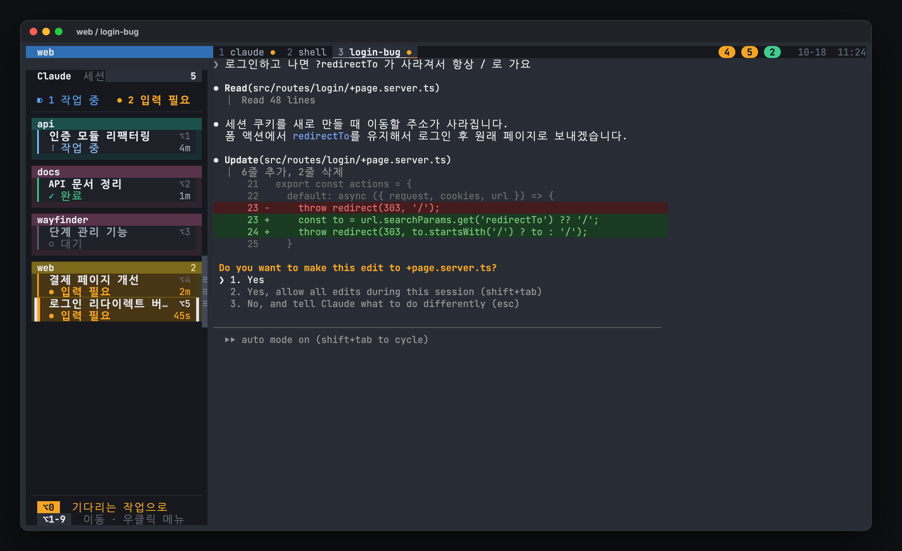
</p>

## 기능

- **모든 세션을 한 판에:** 프로젝트마다 그 색의 상자가 있고, 안에 Claude마다 카드가 실시간 상태와 경과 시간을 보여 줍니다. 작업 중인 카드는 빛 띠가 지나가고, 입력이 필요한 카드는 호박색으로 깜빡이고, 지금 보는 카드는 양옆에 흰 선이 생깁니다. 사이드바를 넓히면 2열, 3열이 되고, 목록이 길면 마우스 휠로 스크롤합니다.
- **알림:** 작업이 입력을 기다리거나 끝나면 macOS 알림이 뜹니다. 지금 보고 있는 작업은 빼고 알립니다. 설정에서 끌 수 있습니다.
- **어디로든 바로 이동:** `Option+1`부터 `Option+9`까지, `Option+0`(가장 오래 기다린 작업), 카드 클릭으로 이동합니다.
- **호출판:** 푸드코트 주문 알림판처럼, 맨 위 상태줄 오른쪽에 입력이 필요한 작업(호박색)과 끝났지만 아직 안 본 작업(초록)이 프로젝트와 상관없이 동그란 번호 배지로 뜹니다. 번호는 그 작업의 `Option` 번호입니다. 입력이 필요한 작업은 답할 때까지, 끝난 작업은 처음 10초 동안 깜빡입니다. 배지를 누르면 그 작업으로 가고, 끝난 작업은 한 번 보면 사라집니다.
- **벌 사무실:** Claude 세션마다 벌 한 마리가 작은 사무실에서 일합니다. 누가 일하고, 누가 나를 기다리고, 누가 끝났는지 한눈에 보입니다. [벌 사무실](#벌-사무실) 참고.
- **기다리는 이유, 사무실에서 답하기:** 기다리는 카드에 무엇을 기다리는지 나옵니다. 승인(Claude가 직접 쓴 명령 설명이나 고칠 파일), 계획 승인, 질문, 오류입니다. 끝난 카드에는 그 턴에 고친 파일 수가 나오고, 배경 에이전트가 아직 일하는 채로 턴이 끝나면 정말 끝날 때까지 "에이전트 2개 실행 중"으로 보입니다. 벌 사무실에서는 기다리는 벌의 말풍선을 눌러 바로 답할 수 있습니다.
- **퇴근과 출근:** 밤에는 모든 Claude를 끄고 아침에 같은 대화로 다시 띄웁니다. 그동안 벌들은 마을의 집으로 퇴근했다가 걸어서 출근합니다.
- **작업 이름:** Claude가 정한 대화 제목을 보여 줍니다. 카드를 더블클릭하거나 오른쪽 클릭 메뉴의 "이름 바꾸기"로 이름을 바꿀 수 있습니다. 바꾼 이름은 `/rename`으로 Claude에 전달되고, Claude가 작업 중이면 끝날 때까지 기다렸다가 보냅니다.
- **원하는 순서:** 카드를 끌어 작업 순서를, 프로젝트 이름 줄을 끌어 프로젝트 순서를 바꿉니다. `Option+숫자` 번호와 맨 위 창 목록도 같은 순서를 따릅니다.
- **Claude Code 업데이트:** 오른쪽 클릭 메뉴 → "Claude 업데이트"(또는 `hivemux update-claude`)는 새 버전이 있는지 먼저 보고, 확인을 받은 뒤 Claude Code를 업데이트하고(Homebrew로 설치했으면 brew로. 이미 최신이면 "최신 버전입니다"만 보여 줌), 칸마다 Claude를 새 버전으로 다시 시작합니다. 대화는 그대로 이어집니다. 일하는 중이거나, 나를 기다리거나, 화면에 보이는 Claude는 일이 끝나고 화면에서 벗어났을 때 다시 시작합니다.
- **노트북에서 이어서:** Claude는 데스크톱 Mac에서 돌리고, 노트북에서 `hivemux connect`로 붙어 이어서 합니다. ssh 창 하나로 끝나지 않습니다. 노트북에서 찍은 스크린샷을 원격 Claude에 `Ctrl+V`로 붙이고, 거기서 띄운 개발 서버를 노트북의 `localhost`로 열고, Claude가 거기서 만든 파일을 노트북에서 열고, 알림도 노트북에 뜹니다. [다른 Mac에서 이어서 작업](#다른-mac에서-이어서-작업) 참고.
- **끊기지 않음:** 터미널을 닫아도 tmux가 세션을 살려 둡니다. 재부팅하면 tmux-resurrect가 배치를 복원하고, hivemux가 알맞은 칸에서 `claude --resume <id>`를 실행합니다.
- **프로젝트:** `hm ~/code/api`로 폴더 하나에 tmux 세션 하나를 엽니다. 이름 붙인 Claude 창과 셸 창이 함께 생깁니다.
- **Claude가 말한 경로 열기:** `Option+O`를 누르면 그 칸의 최근 출력에 나온 파일 경로가 목록으로 나옵니다. Enter를 누르면 설정에서 고른 편집기(VS Code, Cursor, Zed, Sublime Text, 텍스트 편집기)로 그 줄을 엽니다. 다른 Mac에서 붙은 화면이면 VS Code와 Cursor는 그 Mac에서 원격 SSH로 열고, Tab(기본 앱)은 파일을 그 Mac으로 복사해 거기서 엽니다. `hivemux open <파일>`도 같은 식이라, 원격으로 일할 때 Claude가 만든 스크린샷을 노트북에서 바로 볼 수 있습니다.
- **폰에서:** 원하면 모든 세션의 Remote Control을 켭니다. Claude 앱에서 같은 세션을 보고 조작할 수 있습니다.
- **설정을 덮어쓰지 않는 설치:** 기존 설정 파일에 표시된 블록만 추가하고, `hivemux uninstall`로 그 블록만 정확히 지웁니다.

## 벌 사무실

<p align="center">
  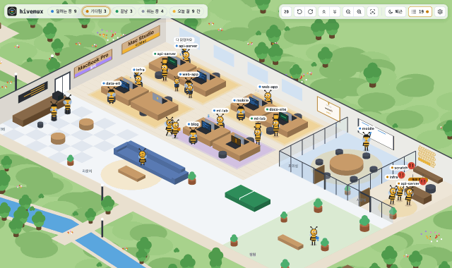
</p>

사이드바 맨 위의 🐝 버튼(또는 `prefix B`, 오른쪽 클릭 메뉴, `hivemux office`)으로 창을 열면 Claude 세션마다 벌 한 마리가 일합니다.

- **일하는 벌**은 자기 책상에서 타자를 치고, 서브에이전트는 책상 옆의 작은 부사수 벌이 됩니다. 계획 모드면 회의실 화이트보드 앞에서 계획을 세웁니다.
- **나를 기다리는 벌**은 사장실 질문 창구로 뛰어가 줄을 서고, 오래 기다리면 창 앞으로 튀어나옵니다.
- **끝난 벌**은 꿀단지를 들고 있다가, 확인하고 나면 벌집에 꿀 한 칸을 채우고 라운지에서 쉽니다. 벌집이 다 차면 꿀단지에 담겨 선반에 쌓입니다.
- 벌을 누르면 그 세션으로 갑니다. ☰ 버튼(또는 `L`)을 누르면 세션 목록이 서랍으로 열립니다. 서랍 위치(오른쪽/왼쪽)는 설정에서 고릅니다. **꿀 순위** 탭에서 오늘, 이번 주, 이번 달 꿀을 가장 많이 모은 벌을 보고, 이달 1등은 벽의 액자에 걸립니다.
- 마우스로 돌리고, 기울이고, 확대합니다. 돌릴 때는 누른 자리를 중심으로 돕니다. **2D**를 누르면 같은 사무실을 바로 위에서 내려다봅니다. 끝까지 줄이면 사무실이 작은 행성 위에 있습니다.
- `hivemux connect`로 붙어 있는 Mac의 세션은 따로 책상을 받습니다. Mac마다 그 색의 카펫이 깔리고 벽에 이름 명패가 붙습니다.
- 창 앱을 만들 Swift 컴파일러가 없으면 Chrome, Edge, Brave, 웨일, Vivaldi, Chromium의 앱 창(탭과 주소창 없음)으로 열고, 없으면 브라우저로 엽니다. 사무실 서버가 꺼지면 페이지가 "다시 연결하는 중"을 보여 주며 계속 다시 시도하고, 벌 사무실 창은 서버를 스스로 다시 띄웁니다.

<p align="center">
  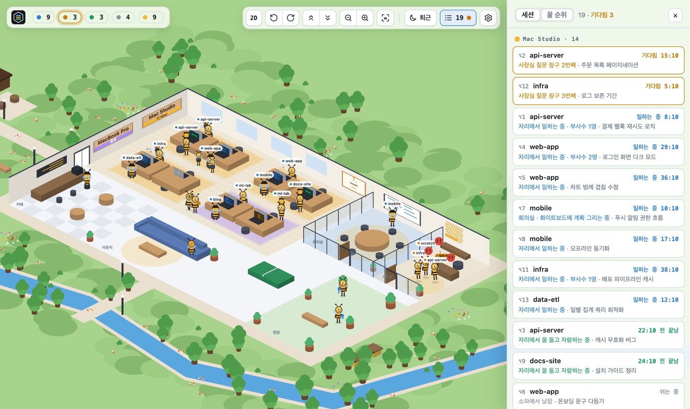
  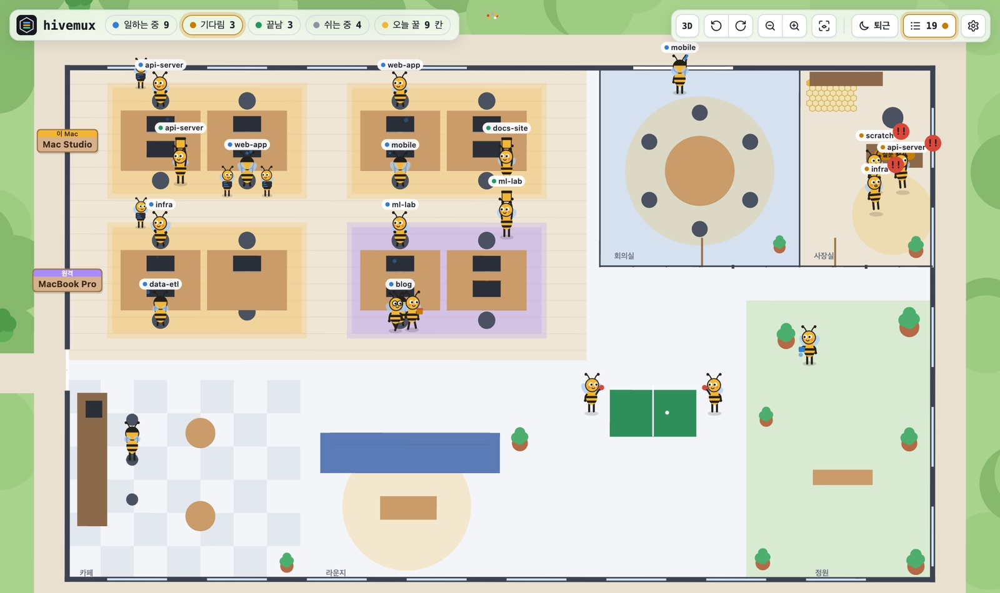
</p>

### 사무실에서 답하기

나를 기다리는 벌은 큰 말풍선으로 이유를 보여 줍니다. ✋ 승인(Claude가 쓴 명령 설명이나 고치려는 파일), 📋 계획 승인, ❓ 질문, ✎ MCP 서버의 입력 요청, ⚠ 오류입니다. 말풍선(또는 벌)을 누르면 터미널과 같은 선택지가 카드에 나오고, 누르면 그 자리에서 답이 들어갑니다. 글을 받는 선택지(직접 입력, 고칠 점 알려 주기)는 입력 칸이 열리고, 질문이 여러 개면 하나씩 답한 뒤 확인 화면이 나옵니다. 붙어 있는 다른 Mac의 벌에도 됩니다. 그사이 화면이 바뀌었으면 아무것도 누르지 않습니다.

### 퇴근과 출근

<p align="center">
  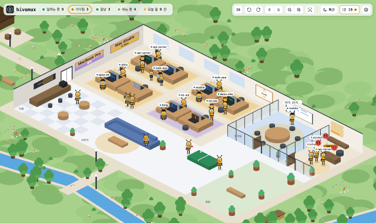
</p>

🌙 **퇴근** 버튼(또는 사이드바 빈 곳 오른쪽 클릭 → 모두 퇴근하기…)을 누르면 Claude를 끕니다. Mac별로 하거나 모두 한꺼번에 할 수 있습니다. 벌들은 박수를 치고 마당 너머 마을의 자기 집으로 걸어갑니다. 일하거나 나를 기다리던 Claude는 야근하다가 끝나면 퇴근합니다. ☀️ **출근**을 누르면 모두 같은 대화로 다시 시작하고(`claude --resume`), 벌들은 걸어서 출근합니다. 퇴근 중에 재부팅하면 다시 띄우지 않습니다.

Claude 하나나 프로젝트 하나만 먼저 퇴근시킬 수도 있습니다. 카드를 오른쪽 클릭 → 이 Claude 퇴근…, 또는 프로젝트 이름을 오른쪽 클릭 → 이 프로젝트 퇴근…을 고르면 나머지는 계속 일합니다. 카드는 사이드바에 흐리게 남고("퇴근 · 오른쪽 클릭으로 출근"), 오른쪽 클릭 → 출근을 고르면 같은 대화로 다시 출근합니다(그냥 누르면 아무 일도 없어서, 프로젝트를 고르다 잘못 눌러도 괜찮습니다). 모두 출근할 때도 같이 돌아옵니다.

퇴근한 벌들은 자기 전에 놉니다. 펍 "꿀단지" 테라스에서 건배하거나 안에서 다트를 던지고, 공원에서 공놀이를 하거나 벤치에 앉거나, 그냥 집에서 쉽니다. 밤 11시부터는 모두 잡니다. 집은 겉모양과 방이 집마다 다르고, 마우스를 올리면 안이 보이며 누가 사는지 나옵니다. 누르면 열린 채로 있습니다.

<p align="center">
  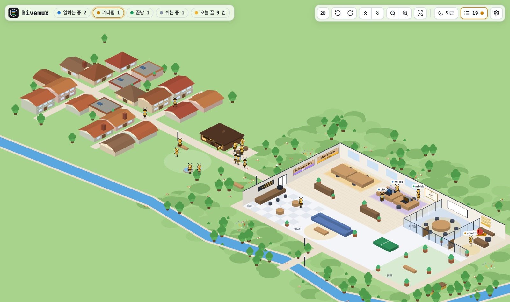
  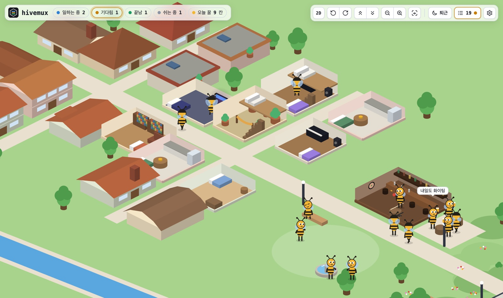
</p>

벌 한 마리는 "프로젝트 + Claude 이름"이라 `/clear`나 새 대화를 해도 같은 벌입니다. 새 이름이 생기면 신입으로 입사하고, 그 Claude를 닫거나(`/exit`, 카드 오른쪽 클릭 → Claude 닫기…, 또는 창을 닫고 10분) 프로젝트를 닫으면 퇴사합니다. 퇴사하는 벌은 짐 상자를 들고 작별 인사를 띄운 채 엘리베이터로 나갑니다. 같은 이름으로 돌아오면 같은 집으로 재입사합니다.

## 필요한 것

- macOS (Linux도 동작할 가능성이 높지만 시험하지 않음)
- tmux 3.3 이상, jq, git, python3 (Xcode Command Line Tools)
- 로그인된 [Claude Code](https://code.claude.com)
- [Ghostty](https://ghostty.org) 권장: `hivemux setup`이 Homebrew로 설치해 줍니다 (다른 터미널에서도 `tmux`를 직접 실행하면 동작)

## 설치

```sh
curl -fsSL https://hivemux.dev/install.sh | bash
```

hivemux를 `~/.local/share/hivemux/src`에 받고 `hivemux setup`을 실행합니다.

Homebrew:

```sh
brew install esteban-eg-kim/tap/hivemux
hivemux setup
```

`hivemux setup`은 세 가지를 묻고, 기본값은 모두 "예"입니다. Ghostty가 아직 없으면 하나를 더 묻습니다.

| 질문 | 바뀌는 것 |
|---|---|
| Ghostty 설치 | `brew install --cask ghostty` (`--yes`로는 설치하지 않음) |
| 권장 키 사용 | 접두키 `Ctrl+A` (Claude Code가 `Ctrl+B`를 씀), `\|` `-` 분할 |
| Ghostty를 tmux에 연결 | Ghostty 설정에 `command = hivemux-attach` |
| 모든 세션 Remote Control | `~/.claude/settings.json`의 `remoteControlAtStartup` |

tmux-resurrect와 tmux-continuum도 받아 옵니다. 이미 `~/.tmux/plugins`에 있으면 그것을 씁니다. Claude Code 훅 열한 개도 등록합니다. `hivemux doctor`로 전체를 점검할 수 있습니다. `--yes`는 기본값으로 진행하고, `--no-keys`, `--no-ghostty`, `--no-remote`는 해당 부분을 건너뜁니다. 화면 언어는 셸 언어로 정해지고, `--lang=en` 또는 `--lang=ko`로 바꿀 수 있습니다. 설치한 뒤에는 사이드바 오른쪽 클릭 메뉴의 "설정"에서 바꿉니다. 끝나면 Ghostty를 열고, 처음 설치했다면 첫 창이 프로젝트 폴더를 묻습니다. 명령을 몰라도 바로 시작할 수 있습니다.

### 다른 터미널

```sh
hivemux terminal iterm      # wezterm, kitty, alacritty, terminal (기본 터미널), ghostty
hivemux terminal iterm --off
```

그 터미널도 Ghostty처럼 창을 열 때마다 사이드바가 있는 tmux 안으로 들어갑니다. 그 터미널에서 `hivemux setup`을 실행하면 setup도 묻습니다(기본값 "아니오"). 자기 블록만 쓰고, iTerm2는 따로 된 프로필("hivemux")을 만들어 기본으로 정하므로 `--off`와 `hivemux uninstall`은 그것만 뺍니다. 기본 터미널(Terminal.app)은 `~/.zshrc`에서 띄웁니다. Option 키를 쓰려면 터미널 설정 → 프로파일 → 키보드 → "Option을 Meta 키로 사용"을 켜세요.

### 업데이트

```sh
brew update && brew upgrade hivemux && hivemux setup    # Homebrew
curl -fsSL https://hivemux.dev/install.sh | bash   # git 설치: 같은 명령
```

`hivemux setup`은 다시 실행해도 안전합니다. 자기가 넣은 블록과 훅만 바꾸고(새 버전에서 훅이 늘 수 있음), 실행 중인 tmux 설정을 다시 읽고 사이드바를 다시 띄웁니다. 쓰던 세션은 그대로입니다. 업데이트 전에 시작한 Claude는 다시 시작해야 새 훅을 씁니다. Claude Code 자체는 오른쪽 클릭 메뉴 → "Claude 업데이트"(`hivemux update-claude`)로 업데이트합니다. 설치된 버전은 `hivemux version`으로, 바뀐 내용은 [CHANGELOG.md](CHANGELOG.md)에서 확인합니다.

## 처음 쓰는 순서

1. Ghostty를 엽니다. 이미 tmux 안이고, 왼쪽에 사이드바가 있습니다. 처음 설치한 직후에는 폴더 고르기 창이 첫 프로젝트를 묻습니다. 폴더를 고르고 `Enter`를 누르면 그 폴더에서 Claude가 시작됩니다.
2. `hm ~/code/api`를 입력하거나 오른쪽 클릭 → 새 프로젝트를 고르면 api 프로젝트가 열리고 1번 창에서 Claude가 실행됩니다.
3. `hm ~/code/web`을 입력하면 두 번째 프로젝트가 열립니다. 첫 번째는 계속 일합니다.
4. 사이드바를 보다가 `Option+0`으로 기다리는 작업으로 갑니다.
5. `prefix` 다음 `Shift+C`로 같은 프로젝트에 이름 붙인 Claude를 추가합니다.
6. Ghostty는 언제 닫아도 됩니다. 다시 열면 보던 곳으로 돌아옵니다.

## 키

| 키 | 동작 |
|---|---|
| `Option+1` … `9` | 그 번호 Claude로 이동 (세션이 달라도) |
| `Option+0` / `prefix Space` | 가장 오래 기다린 Claude, 없으면 안 본 완료 작업 |
| 카드 / 프로젝트 이름 클릭 | 이동. 카드 더블클릭은 이름 바꾸기. Claude 창을 모두 닫은 프로젝트도 닫을 때까지 목록에 남음 ("Claude 없음") |
| 오른쪽 클릭 | 메뉴. 작업 카드: 이동, 이름 바꾸기, 위/아래로 옮기기, 이 Claude 퇴근, Claude 닫기, 새 Claude, 새 프로젝트. 프로젝트 이름 줄: 이름 바꾸기, 프로젝트 닫기, 이 프로젝트 퇴근·출근, 새 Claude, 새 프로젝트. 빈 곳: 새 프로젝트, 모두 퇴근·출근. 모든 메뉴 맨 아래에 경로 열기, 포트 목록, 벌 사무실, Claude 업데이트, 원격 연결, 설정. 마우스나 `↑↓` `Enter`, 괄호 안 글자로 고르고 `Esc`로 닫기 |
| 메뉴 → Claude 닫기 | 확인을 받은 뒤 그 Claude를 닫음: 그 칸, 또는 남는 것이 없으면 창까지. 프로젝트의 마지막 창은 셸을 남김. `/exit`처럼 다시 띄우지 않고, 대화는 `claude --resume`으로 이어갈 수 있음 |
| 메뉴 → 새 프로젝트 | 가운데 폴더 탐색 창: `Enter`는 고른 폴더에서 시작 (`hm`과 같음), `→` / `←`는 폴더 안 / 상위로, 글자를 치면 걸러 보기, `Ctrl+N`은 새 폴더 |
| 메뉴 → 설정 | 언어 (한국어 / English), 애니메이션, 알림, 사이드바 폭, 경로 열기 편집기, 이 Mac 이름(벌 사무실과 원격 화면에 보임). 바로 적용되고 저장됨 |
| 카드 / 프로젝트 이름 줄 끌기 | 작업 순서 / 프로젝트 순서 바꾸기 |
| `prefix Shift+↑` / `↓` | 지금 작업을 위 / 아래로 (프로젝트 끝이면 프로젝트가 움직임) |
| `Option+O` / 메뉴 → 경로 열기 | 최근 출력의 파일 경로 열기 (Enter 설정의 편집기, Tab 기본 앱, ^F Finder, ^Y 복사) |
| `Option+W` / 메뉴 → 포트 목록 | 두 Mac 사이에 이어진 개발 서버 포트 (Enter 이어진 Mac 의 브라우저로 열기, ^Y 주소 복사) |
| `prefix Shift+C` | 이 폴더에서 이름 붙인 Claude 새 창 (이름은 팝업에서 물음) |
| 메뉴 → 원격 연결 | 다른 Mac의 hivemux를 새 Ghostty 창으로 (`hivemux connect --add`로 등록한 호스트) |
| `prefix Shift+H` | 마지막 원격 호스트에 다시 연결 |
| `prefix Shift+B` | 벌 사무실 창 열기 (사이드바 맨 위 🐝 버튼도 같음) |
| `prefix Shift+R` | Remote Control 서버 창 (폰에서 새 세션 시작) |
| `prefix b` | 사이드바 숨기기 / 보이기 |
| `prefix s` / `prefix Shift+S` | 세션 목록 / 전체 트리 |
| 사이드바 핸들 끌기 | 폭 조절, 저장됨. 넓히면 프로젝트 상자가 2–3열 |
| 사이드바 위에서 마우스 휠 | 목록이 다 안 들어갈 때 스크롤 (모든 창이 같은 위치) |

권장 키를 쓰면 `prefix`는 `Ctrl+A`이고, 아니면 tmux 기본값 `Ctrl+B`입니다.

<p align="center">
  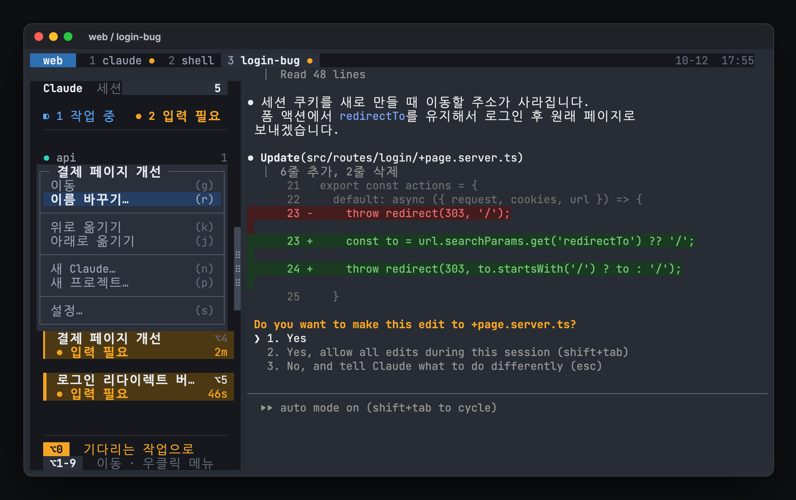
  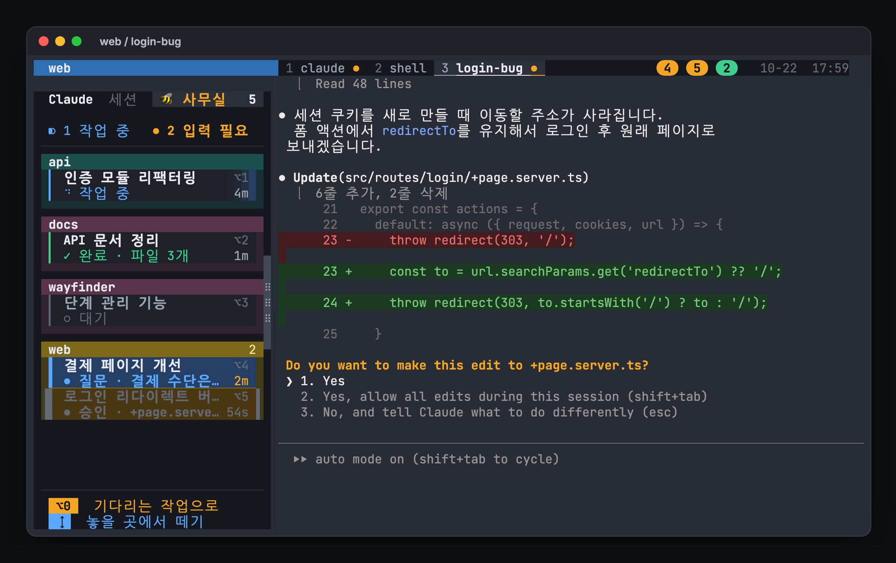
  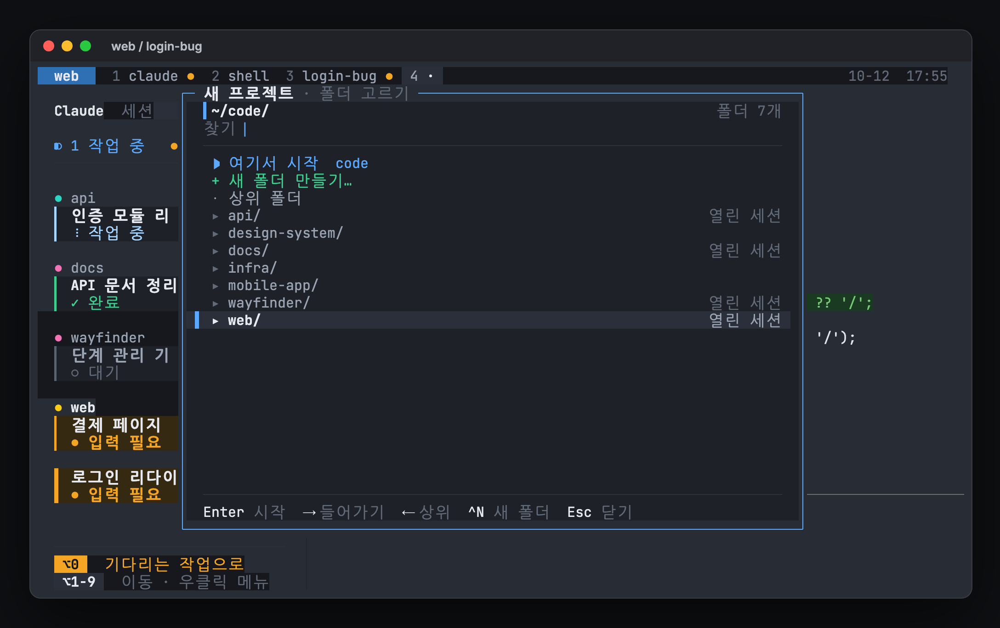
  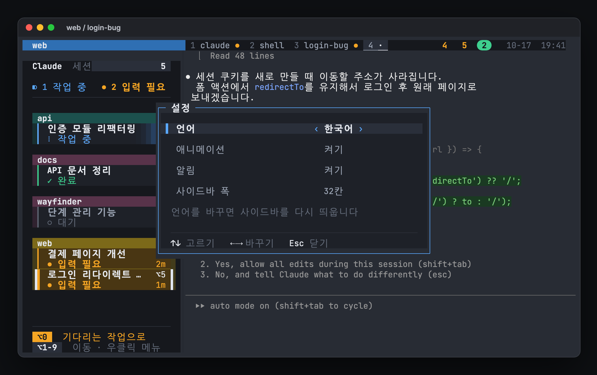
</p>

## 다른 Mac에서 이어서 작업

작업은 한 Mac(예: 사무실 Mac)에서 계속 돌리고, 다른 Mac(예: 노트북)에서 이어서 할 수 있습니다. 노트북이 ssh로 그 Mac의 tmux에 붙어 같은 사이드바와 세션을 봅니다. 연결이 끊겨도 작업은 계속됩니다. 노트북의 로컬 작업은 그대로 두고, 원격은 따로 창을 엽니다.

원격 터미널은 다른 도구로도 열 수 있습니다. hivemux는 두 Mac 사이의 경계를 없앱니다. 노트북에서 방금 찍은 스크린샷, 데스크톱에서 돌고 있는 개발 서버, Claude가 거기서 만든 파일을 Claude가 노트북에서 도는 것처럼 씁니다.

<p align="center">
  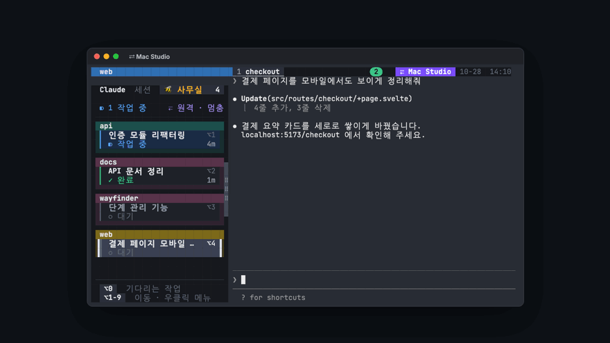
</p>

### 연결하기

**붙는 대상 Mac**에서는 hivemux를 설치하고, 시스템 설정 → 일반 → 공유 → **원격 로그인**을 켜고, 자동으로 잠들지 않게 해 둡니다.

**붙는 쪽 Mac**에서는:

```sh
hivemux connect --add me@work-mac.local    # 확인하고 등록 (mosh를 쓰려면 --mosh)
hivemux connect me@work-mac.local          # 또는 오른쪽 클릭 → 원격 연결, prefix Shift+H
```

처음 등록할 때는 `--add`(또는 원격 연결 목록의 "+ 호스트 추가…")가 호스트를 믿을지와 상대 Mac의 로그인 비밀번호를 한 번 묻고, 이 Mac의 ssh 키를 상대에 등록합니다. 키가 없으면 새로 만듭니다. 그다음부터는 비밀번호를 묻지 않습니다.

호스트에는 `ssh`에 쓰는 것이면 무엇이든 넣습니다. `~/.ssh/config`의 `Host`, `사용자@주소`, VPN 안의 기기 이름 모두 됩니다. 같은 네트워크에서는 `이름.local`로 붙고, 밖에서는 [Tailscale](https://tailscale.com) 같은 VPN을 두 Mac에 설치하는 방법이 간단합니다. 공유기 포트 포워딩으로 ssh를 인터넷에 여는 것은 권하지 않습니다.

### 스크린샷을 Ctrl+V로

Claude Code는 자기가 도는 Mac의 클립보드에서만 이미지를 읽습니다. 그래서 그냥 ssh로 붙으면 노트북에서 찍은 스크린샷이 Claude에 닿지 않습니다. hivemux에서는 원격 Claude 칸에서 평소처럼 `Ctrl+V`를 누르면 됩니다. 노트북 클립보드의 이미지가 건너가 Claude에 `[Image #1]`로 들어갑니다. 깨진 화면을 찍고(`⌘⌃⇧4`로 찍으면 클립보드에 들어감) `Ctrl+V`를 누른 뒤 무엇이 문제인지 물어보면 됩니다. 두 Mac 모두 hivemux 0.1.26 이상이어야 합니다.

<p align="center">
  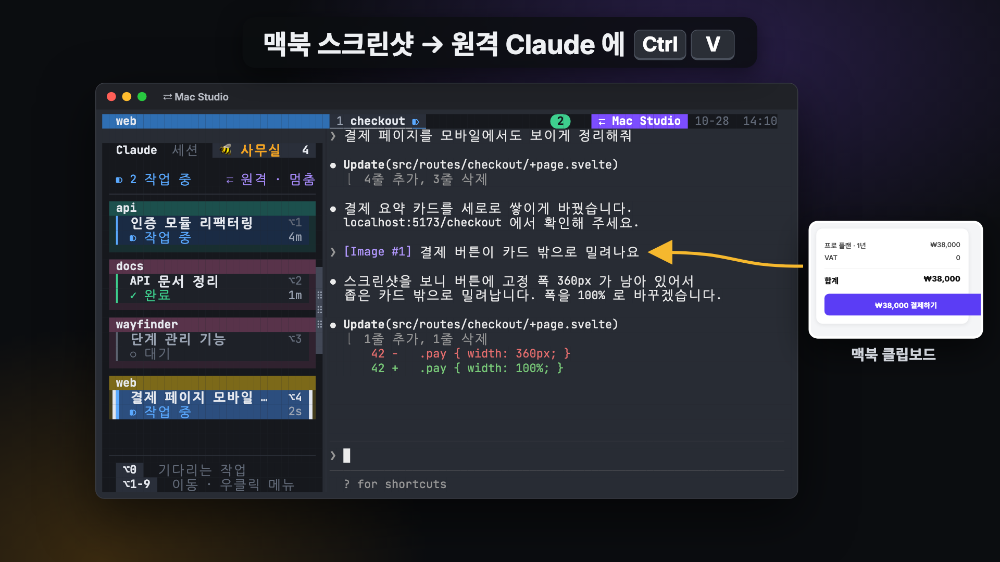
</p>

### 함께 되는 것

- **개발 서버를 내 `localhost`로:** 연결해 있는 동안 상대 Mac에서 띄운 개발 서버(원격 칸의 `npm run dev` 등)는 이 Mac의 `localhost` 같은 포트로 이어집니다. 이 Mac에서 이미 쓰는 포트면 다음 빈 포트로 잇습니다. `Option+W`(또는 메뉴 → 포트 목록)로 어느 Mac에서든 목록을 보고, Enter를 누르면 접속한 Mac의 브라우저로 열립니다. `HIVEMUX_PORTS=0`이면 끕니다.
- **파일은 노트북에서 열기:** 원격 칸에서 `hivemux open <파일>`(또는 `Option+O` 팝업의 Tab)을 실행하면 파일을 이 Mac으로 복사해 기본 앱으로 엽니다. 그래서 Claude가 거기서 만든 스크린샷이 여기 뜹니다. 편집기를 VS Code나 Cursor로 정해 두면 `Option+O`가 원격 SSH로 그 경로를 엽니다. 거기서 🐝를 누르면 벌 사무실도 여기서 열립니다. 두 Mac 모두 hivemux 0.1.29 이상이어야 합니다.
- **알림은 여기로:** 원격 작업이 나를 기다리거나 끝나면 이 Mac에 알림이 뜹니다.
- **연결은 알아서:** 연결이 끊기면 화면 가운데 상자에 다음 연결까지 남은 시간이 나오고 저절로 다시 연결합니다(`Enter` 지금 연결, `Ctrl+C` 그만). `prefix d`로 떼면 창이 닫힙니다. `--mosh`로 등록하거나 메뉴 → 원격 연결… 목록에서 `m`을 누르면 잠자기와 네트워크 변경을 스스로 견딥니다. 대신 알림이 mosh를 지나가지 못하며, 목록에는 "mosh · 알림 없음"으로 표시됩니다. 두 Mac 모두 `brew install mosh`가 필요합니다. "Nothing received from server on UDP port"에서 멈추면 상대 Mac의 방화벽에서 `mosh-server`의 수신 연결을 허용하세요.
- **어디에 붙었는지 표시:** 원격 창은 상태줄 오른쪽 시계 앞에 `⇄ Mac 이름`이 표시됩니다.
- **두 화면, 한 프로젝트:** 두 화면에서 같은 프로젝트를 보면 화면을 같이 씁니다. 한쪽에서 창을 바꾸면 다른 쪽도 바뀝니다.
- **네트워크를 아끼기:** 원격 화면이 보고 있는 창에서는 사이드바가 움직이지 않습니다 (카드 깜빡임, 상태줄 스피너 없음). 애니메이션 한 장면 한 장면이 모두 네트워크로 가기 때문입니다.

## 동작 원리

| 층 | 역할 |
|---|---|
| Ghostty | 화면을 그립니다. 모든 창이 `hivemux-attach`를 실행해 tmux에 붙습니다 |
| tmux | 터미널을 닫아도 프로세스를 살려 둡니다 |
| tmux-resurrect + continuum | 5분마다 배치를 저장하고, 처음 시작할 때 복원합니다 |
| Claude Code 훅 | 세션 ID와 상태를 tmux 칸에 기록합니다 (`hivemux-hook`) |
| 사이드바 | 그 상태를 1초마다 읽어 상태판을 그립니다 (`hivemux-sidebar-view`) |
| 벌 사무실 | 작은 로컬 서버(`hivemux-office`)가 사무실 페이지를 창에 보여 줍니다. `hivemux-bees`가 명부와 꿀 장부를, `hivemux-shift`가 퇴근·출근을 맡습니다 |

복원할 때 `hivemux-panes`가 저장된 칸과 Claude 세션 ID를 짝지어, 칸마다 `claude --resume <id>`를 입력합니다. `/exit`로 직접 끝낸 세션은 재개하지 않고, 퇴근 중에는 아무것도 재개하지 않습니다.

## 문제 해결

```sh
hivemux doctor                     # 의존성과 연결 점검
hivemux-panes list                 # 재부팅 후 재개할 칸 목록
tmux set -g @hivemux-anim off      # 애니메이션 끄기 (계속 끄려면 메뉴 → 설정)
tmux set -g @hivemux-fps 15        # 애니메이션 프레임 줄이기, CPU 절약 (기본 30)
hivemux-sidebar respawn            # 모든 사이드바 다시 띄우기
touch ~/tmux_no_auto_restore       # 다음 시작 때 복원 건너뛰기
```

자세한 내용은 그림 가이드 [`docs/guide.html`](docs/guide.html)([English](docs/guide.en.html))에 있습니다. 내려받아 브라우저로 여세요.

## 제거

```sh
hivemux uninstall
```

`~/.tmux.conf`, Ghostty 설정, `~/.zshrc`에서 hivemux 블록을 지우고, Claude Code 설정에서 hivemux 훅을 지웁니다. 저장된 배치와 백업은 `~/.local/share/hivemux`에 남습니다.

## 라이선스

MIT. hivemux는 독립 프로젝트이며 Anthropic과 관련이 없고 Anthropic의 보증을 받지 않았습니다. "Claude"와 "Claude Code"는 Anthropic의 상표입니다.
