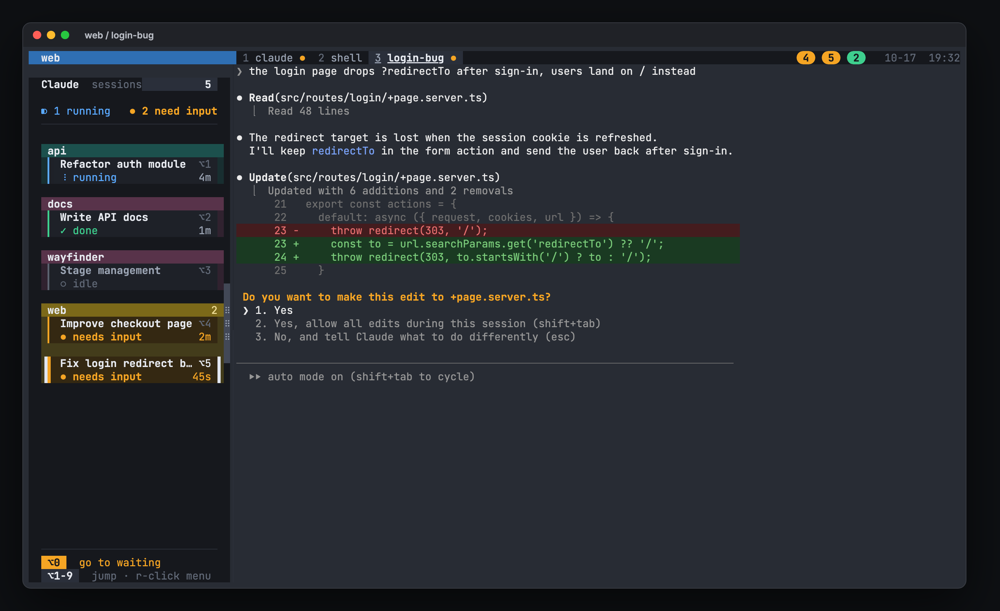
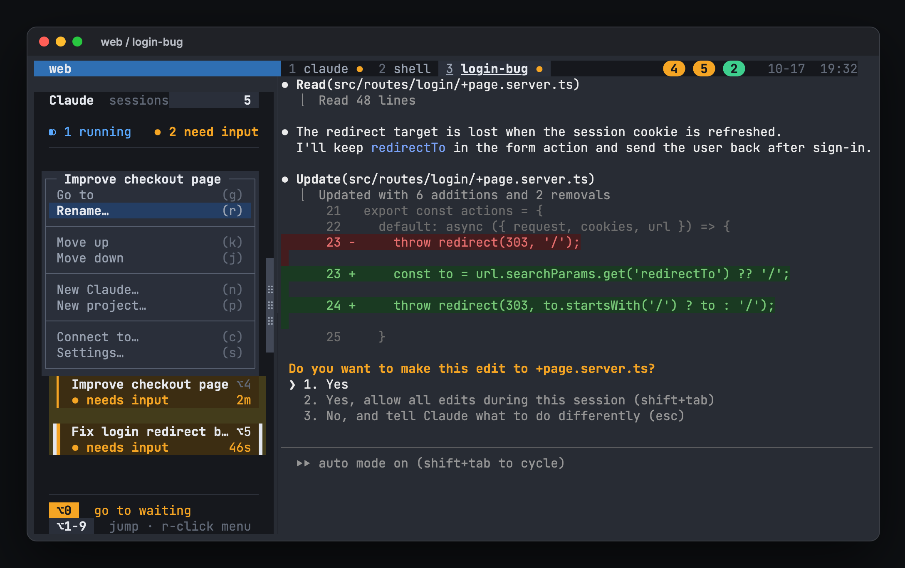
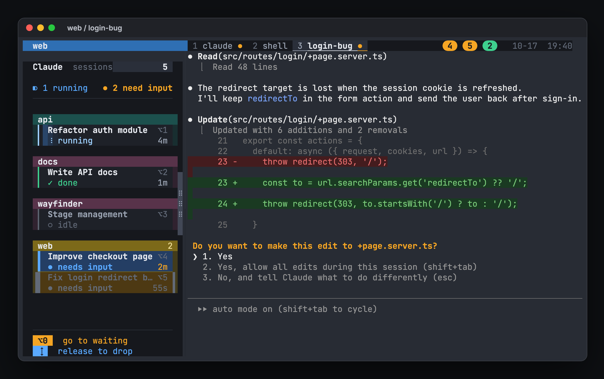
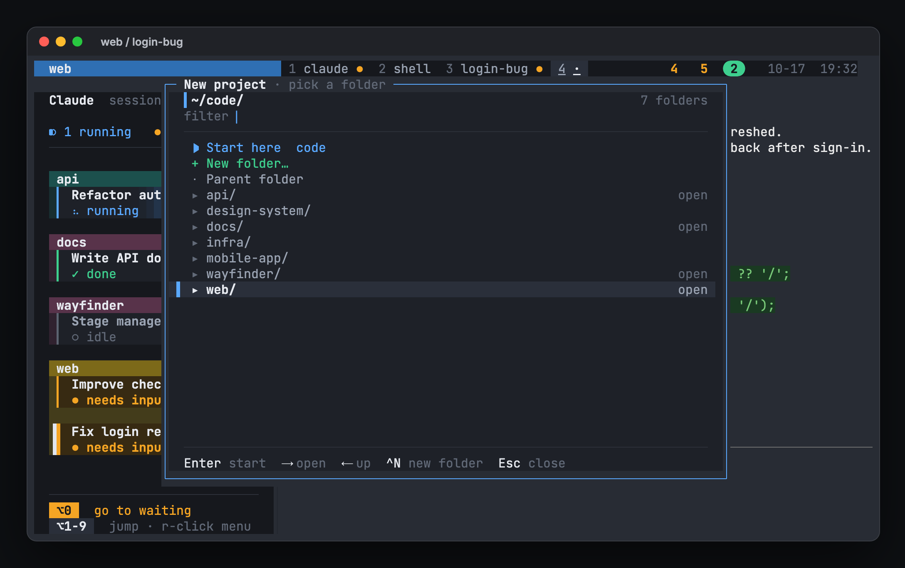
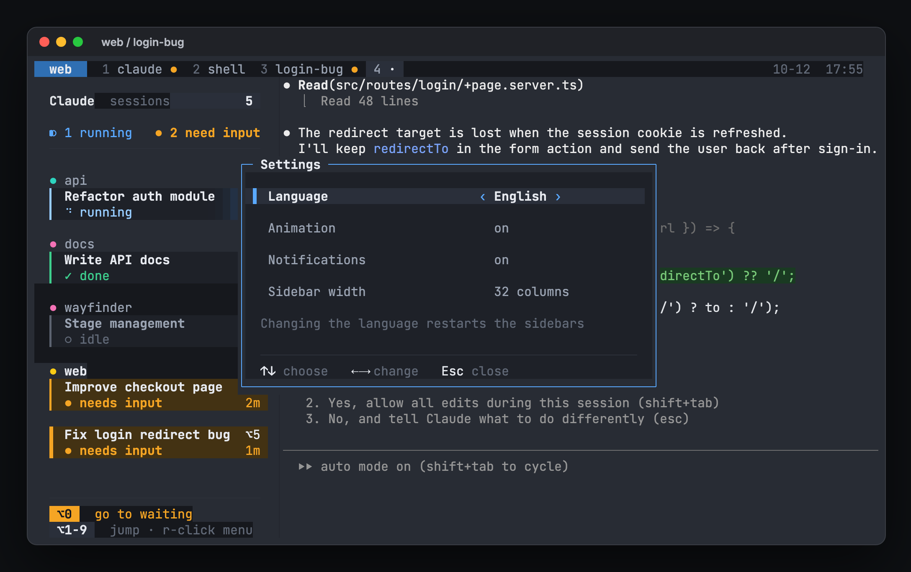

#  hivemux

**English** · [한국어](README.ko.md)

**Run five Claude Code sessions at once and always know which one needs you.**

hivemux adds a sidebar to every tmux window that lists every Claude Code session
in every tmux session: what it is working on, whether it is running, waiting for
your approval, or done, and for how long. Press `Option+3` to jump to the third
one, or `Option+0` to jump to whichever has waited longest. Close the terminal or
reboot the Mac and everything comes back, with each Claude resumed in its pane.

<p align="center">
  
</p>

## Features

- **One board for every session.** A box per project in its own color, with a
  card per Claude showing live state and elapsed time. Running cards glow,
  waiting cards pulse amber, and the one you are in has a white line on each
  side. Widen the sidebar for 2 or 3 columns; a long list scrolls with the wheel.
- **Notifications.** A macOS notification when a task needs input or finishes,
  except the one you are looking at. Turn it off in Settings.
- **Jump anywhere.** `Option+1..9`, `Option+0` (oldest waiting), or click a card.
- **Pickup board.** Like the order board at a food court, the right of the top
  status line shows a round number badge (the task's `Option` number) for every
  task, in any project, that needs input (amber) or finished and is not seen
  yet (green). A waiting one blinks until you answer, a finished one for its
  first 10 seconds. Click a badge to go there; a finished one leaves once you
  look at it.
- **Bee office.** The 🐝 button at the top of the sidebar (or `prefix B`, the
  right-click menu, `hivemux office`) opens a window where every Claude session is
  a bee in a small office: it types at its desk while working, runs to the
  question window in the boss room when it needs you (and pops out in front of
  the window), holds up a jar of honey when done, stores it in the honeycomb
  once you have looked, then rests in the lounge. A task running subagents holds
  a meeting. Click a bee to go to its session. Sessions of a Mac you are
  connected to with `hivemux connect` work in an office of their own.
- **Task names.** Shows Claude's own conversation title. Double-click a card
  (or right-click → Rename) to rename it; hivemux sends `/rename` to that Claude (waits if it is busy).
- **Your order.** Drag a card to reorder tasks, or a project header to reorder
  projects. `Option+N` numbers and the top window list follow the same order.
- **Survives everything.** tmux keeps sessions alive when the terminal closes;
  tmux-resurrect restores layouts after a reboot and hivemux runs
  `claude --resume <id>` in the right pane.
- **Projects.** `hm ~/code/api` opens one tmux session per folder with a named
  Claude window and a shell window.
- **Open paths Claude mentions.** `Option+O` lists file paths from the pane's
  recent output; Enter opens it at the line in the editor chosen in Settings
  (VS Code, Cursor, Zed, Sublime Text or the text editor). From a screen
  attached from another Mac, VS Code and Cursor open it on that Mac over Remote-SSH.
- **From your phone.** Optionally turns on Remote Control for every session, so
  the Claude app shows and drives the same sessions.
- **Polite installer.** Adds marked blocks to your configs and removes exactly
  those on `hivemux uninstall`.

## Requirements

- macOS (Linux likely works but is untested)
- tmux 3.3+, jq, git, python3 (Xcode Command Line Tools)
- [Claude Code](https://code.claude.com) logged in
- [Ghostty](https://ghostty.org) recommended (any terminal works if you start `tmux` yourself)

## Install

```sh
curl -fsSL https://raw.githubusercontent.com/esteban-eg-kim/hivemux/main/install.sh | bash
```

This clones hivemux into `~/.local/share/hivemux/src` and runs `hivemux setup`.

Homebrew:

```sh
brew install esteban-eg-kim/tap/hivemux
hivemux setup
```

`hivemux setup` asks three questions (all default to yes):

| Question | What it changes |
|---|---|
| Recommended keys | prefix `Ctrl+A` (Claude Code uses `Ctrl+B`), `\|` / `-` splits |
| Ghostty attaches to tmux | `command = hivemux-attach` in Ghostty config |
| Remote Control for all sessions | `remoteControlAtStartup` in `~/.claude/settings.json` |

It also downloads tmux-resurrect and tmux-continuum (or uses yours from
`~/.tmux/plugins`) and registers eleven Claude Code hooks. Run `hivemux doctor` to
check everything. Use `--yes` to accept defaults, `--no-keys`, `--no-ghostty`,
`--no-remote` to skip parts. The screen language follows your shell; pick it with
`--lang=en` or `--lang=ko`, and change it later in the sidebar's right-click menu → Settings.

### Update

```sh
brew upgrade hivemux && hivemux setup    # Homebrew
curl -fsSL https://raw.githubusercontent.com/esteban-eg-kim/hivemux/main/install.sh | bash   # git install: same command
```

`hivemux setup` again is safe: it replaces its own blocks and hooks (a new version
may add hooks), reloads the running tmux and restarts the sidebars, so you keep
working in the same sessions. Claude sessions started before the update pick up
new hooks once restarted. `hivemux version` shows the installed version; see
[CHANGELOG.md](CHANGELOG.md) for what changed.

## Quick start

1. Open Ghostty. You are inside tmux; the sidebar is on the left.
2. `hm ~/code/api` opens project **api** with Claude running in window 1.
3. `hm ~/code/web` opens a second project. The first keeps working.
4. Watch the sidebar. `Option+0` takes you to whatever is waiting for you.
5. `prefix` then `Shift+C` adds another named Claude to the current project.
6. Close Ghostty whenever you like. Open it again and you are back where you were.

## Keys

| Key | Action |
|---|---|
| `Option+1` … `9` | jump to that Claude (any session) |
| `Option+0` / `prefix Space` | oldest waiting Claude, else oldest unseen finished one |
| click card / project name | jump · double click a card: rename. A project whose Claude windows are all closed stays listed ("no Claude") until you close it |
| right click | menu. On a task: go to, rename, move up/down, new Claude, new project. On a project name: rename, close project, new Claude, new project. On empty space: new project. Every menu ends with Open path…, Ports…, Connect to… and Settings. Choose with the mouse, `↑↓` `Enter` or the letter shown; `Esc` closes |
| menu → New project | folder browser in the middle: `Enter` starts the selected folder (like `hm`), `→` / `←` in and out, type to filter, `Ctrl+N` new folder |
| menu → Settings | language (한국어 / English), animation, notifications, sidebar width, editor for Open path; applied at once and saved |
| drag card / project header | reorder tasks / projects |
| `prefix Shift+↑` / `↓` | move the current task up / down (at a project's edge, the project moves) |
| `Option+O` / menu → Open path | open a file path from recent output (Enter editor from Settings, Tab default app, ^F Finder, ^Y copy) |
| `Option+W` / menu → Ports | dev server ports forwarded between Macs (Enter opens in the browser of the Mac they reach, ^Y copies the address) |
| `prefix Shift+C` | new window with a named Claude in this folder |
| menu → Connect to… | another Mac's hivemux in a new Ghostty window (hosts added with `hivemux connect --add`) |
| `prefix Shift+H` | connect to the last remote host again |
| `prefix Shift+B` | open the bee office window (also the 🐝 button at the top of the sidebar) |
| `prefix Shift+R` | Remote Control server window (start new sessions from the phone) |
| `prefix b` | hide / show sidebars |
| `prefix s` / `prefix Shift+S` | session list / full tree |
| drag the sidebar grip | resize; width is saved. Wider: project boxes in 2–3 columns |
| mouse wheel on the sidebar | scroll when the list does not fit (shared by every window) |

`prefix` is `Ctrl+A` with the recommended keys, otherwise tmux's `Ctrl+B`.

<p align="center">
  
  
  
  
</p>

## Work from another Mac

Keep the work running on one Mac (say, the one at the office) and continue it
from another (a laptop): the laptop attaches to the first Mac's tmux over ssh and
sees the same sidebar and sessions. If the connection drops, the work goes on.
Local work on the laptop stays as it is; the remote one opens in its own window.

On the Mac you connect **to**: install hivemux, turn on System Settings →
General → Sharing → **Remote Login**, and keep it from sleeping when idle.

On the Mac you connect **from**:

```sh
hivemux connect --add me@work-mac.local    # check and remember (--mosh to use mosh)
hivemux connect me@work-mac.local          # or: right-click → Connect to…, prefix Shift+H
```

The first time, `--add` (or "+ Add a host…" in the Connect to… list) asks you to
trust the host and for your login password there once, then adds this Mac's ssh
key there (making one if there is none), so later connections need no password.

The host is anything `ssh` takes: a `Host` from `~/.ssh/config`, `user@address`,
or a device name on a VPN. On the same network `name.local` works; from outside,
a VPN such as [Tailscale](https://tailscale.com) on both Macs is the simple way
(opening ssh to the internet with port forwarding is not recommended).

- The remote window shows `⇄ <Mac name>` at the right of the status line, before the clock.
- A dropped connection reconnects by itself: a box in the middle counts down to the next try
  (`Enter` tries now, `Ctrl+C` stops); `prefix d` detaches and closes the window.
- Notifications from the remote tasks show on this Mac.
- Dev servers started there (`npm run dev` in a remote pane) are forwarded to
  the same port on this Mac's `localhost` while connected, with a notification
  for each; a port taken here goes to the next free one. `Option+W` (or
  menu → Ports) lists them on either Mac; Enter opens one in the browser of the
  Mac you connect from. `HIVEMUX_PORTS=0` turns it off.
- `Ctrl+V` in a remote Claude pane pastes the image on this Mac's clipboard (a
  screenshot taken here, say): it is copied over and shows up as `[Image #1]`.
  Both Macs need hivemux 0.1.26 or later.
- With `--mosh` (or `m` in the menu → Connect to… list), the session survives
  sleep and network changes by itself, but notifications do not pass through
  mosh; the list marks such a host "mosh · no notifications". Both Macs need
  `brew install mosh`; if it stops at "Nothing received from server on UDP
  port", allow incoming connections for `mosh-server` in the other Mac's firewall.
- Two screens on the same project share it: switching windows on one moves the other.
- While a remote screen looks at a window, its sidebar keeps still (no pulsing
  cards, no status line spinner): every animation frame would go over the network.

## How it works

| Layer | Job |
|---|---|
| Ghostty | draws. Every window runs `hivemux-attach`, which attaches to tmux |
| tmux | keeps processes alive when the terminal closes |
| tmux-resurrect + continuum | saves layouts every 5 minutes, restores on first launch |
| Claude Code hooks | write session id and state onto the tmux pane (`hivemux-hook`) |
| sidebar | reads that state every second and draws the board (`hivemux-sidebar-view`) |

On restore, `hivemux-panes` maps saved panes to Claude session ids and types
`claude --resume <id>` in each. Sessions you ended with `/exit` are not resumed.

## Troubleshooting

```sh
hivemux doctor                         # check dependencies and wiring
hivemux-panes list                     # panes hivemux will resume after reboot
tmux set -g @hivemux-anim off          # stop animations (to keep them off: menu → Settings)
tmux set -g @hivemux-fps 15            # fewer animation frames, less CPU (default 30)
hivemux-sidebar respawn                # restart every sidebar
touch ~/tmux_no_auto_restore           # skip restore on next launch
```

More in the illustrated guide: [`docs/guide.en.html`](docs/guide.en.html) ([한국어](docs/guide.html)); download it and open it in a browser.

## Uninstall

```sh
hivemux uninstall
```

Removes the hivemux blocks from `~/.tmux.conf`, Ghostty config and `~/.zshrc`,
and the hivemux hooks from Claude Code settings. Saved layouts and backups stay
in `~/.local/share/hivemux`.

## License

MIT. hivemux is an independent project and is not affiliated with or endorsed
by Anthropic. "Claude" and "Claude Code" are trademarks of Anthropic.
