#  hivemux

**English** · [한국어](README.ko.md) · [hivemux.dev](https://hivemux.dev) · [Docs](https://hivemux.dev/docs/)

**Run five Claude Code sessions at once and always know which one needs you.**

hivemux adds a sidebar to every tmux window that lists every Claude Code session
in every tmux session: what it is working on, whether it is running, waiting for
your approval, or done, and for how long. Press `Option+3` to jump to the third
one, or `Option+0` to jump to whichever has waited longest. Close the terminal or
reboot and everything comes back, with each Claude resumed in its pane. When a
Claude account hits its usage limit, the work goes on: switch to another account in the
same conversation, or let hivemux go on with an API key by itself and come back
when the limit resets. It runs on macOS and Linux (on Linux, `Option` is `Alt`).

<p align="center">
  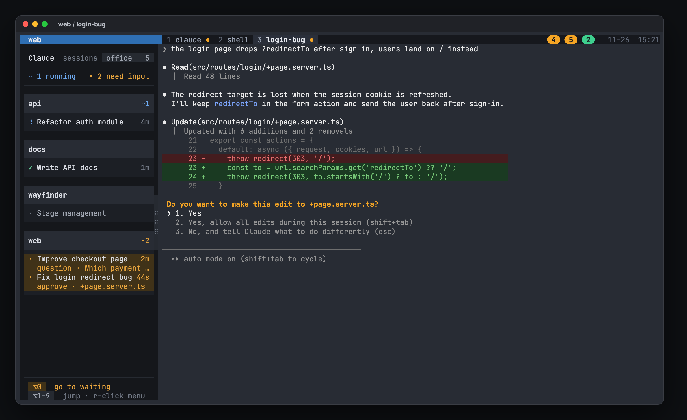
</p>

## What's new

<p align="center">
  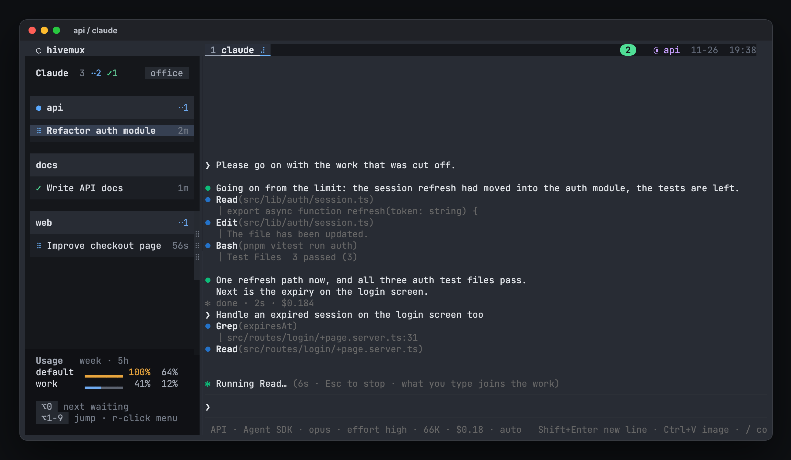
</p>

- **At the usage limit, go on with the API.** Add an API key once; when a
  subscription hits its limit, its Claudes go on in the same pane with the same
  folder, tools, settings and hooks, and turn back into Claude Code when the limit
  resets. It runs on the Agent SDK, so the monthly API credits of the Max, Ultra
  and Team plans ([$100, $200, up to $500](https://support.claude.com/en/articles/17154008-monthly-api-credits-for-max-ultra-and-team-plans))
  work for it. They do not cover Claude Code itself. (0.1.78,
  [how](#more-than-one-claude-account))
- **Team diets that hold.** A role past its line starts fresh from short notes,
  without the tools it does not use: 33K to 46K tokens at the start instead of
  52K, and long days no longer fill up with reading. (0.1.80, [Teams](#teams))
- **Pages as files.** Mockups and reports as one HTML file in the project,
  published only when you want them shared; opinions come back into the file.
  (0.1.80, [Pages](#pages))
- **A lighter sidebar.** With 60 Claudes, from 35% of a core to 6%. (0.1.79)
- **Dev servers on your phone.** `Option+W`, then `p`: the address and a QR code.
  (0.1.75)

Everything, by version: [CHANGELOG](CHANGELOG.md) or
[hivemux.dev/new](https://hivemux.dev/new/).

## Features

- **One board for every session.** A box per project in its own color, with a
  card per Claude showing live state and elapsed time. A band of light
  crosses running cards, waiting cards turn amber, and the one you are in is
  lighter. Widen the sidebar for 2 or 3 columns; a long list scrolls with the wheel.
- **Teams.** Give a project a team of Claudes with roles (research, planning,
  design, dev, QA, marketing), each in its own window, handing work to each
  other by name. Tell the lead the goal; it plans and hands the work out. Set
  it up on the team page from a template or three questions, follow the
  hand-offs in the sidebar and the bee office, and read each day's report. See
  [Teams](#teams).
- **Notifications.** A desktop notification when a task needs input or finishes,
  except the one you are looking at. Turn it off in Settings.
- **Jump anywhere.** `Option+1..9`, `Option+0` (oldest waiting), or click a card.
- **Pickup board.** Like the order board at a food court, the right of the top
  status line shows a round number badge (the task's `Option` number) for every
  task, in any project, that needs input (amber) or finished and is not seen
  yet (green). A waiting one blinks until you answer, a finished one for its
  first 10 seconds. Click a badge to go there; a finished one leaves once you
  look at it.
- **Bee office.** Every Claude session as a bee in a glass office building in
  3D: watch who works, who waits for you, and who is done at a glance, and
  answer a waiting one right there. See [The bee office](#the-bee-office).
- **More than one Claude account.** Hit a usage limit? Log in to another
  account once and switch to it, for every project or for one; each Claude
  restarts on it in the same conversation, and the status line shows
  `◉ <account>`. Or have them go on with an API key by themselves until the limit
  resets. A list of every artifact your Claudes published says which account it
  belongs to. See [More than one Claude account](#more-than-one-claude-account).
- **Why it waits, and answer from the office.** A waiting card says what it
  waits for: an approval (with Claude's own one-line description of the
  command, or the file), a plan, a question, or an error; a finished one says
  how many files the turn changed, and one whose turn ended with background
  work still going says so until it really finishes ("2 agents running",
  "waiting on 1 shell" for a build or a data import; a dev server does not
  count). A resting card shows how much context the Claude carries (`142K`).
  In the bee office, click the waiting bee's bubble and press the answer there.
- **Clock out, clock in.** Stop every Claude for the night and bring them all
  back in the morning, in the same conversations, while the bees go home to
  their flats in the Hive Residence and come back to work.
- **Task names.** Shows Claude's own conversation title. Double-click a card
  (or right-click → Rename) to rename it; hivemux sends `/rename` to that Claude (waits if it is busy).
  A session with no name of its own gets the sidebar's name the first time its turn ends, so the Claude
  app lists it by that name instead of `<host>-local-<word>-<word>`. A Remote Control that reconnected (and lost
  its name in the app) is reconnected with the name (`tmux set -g @hivemux-autoname off` stops both).
- **Your order.** Drag a card to reorder tasks, or a project header to reorder
  projects. `Option+N` numbers and the top window list follow the same order.
  In a team, dragging a role card changes the team's order (the lead stays on top).
- **Work from your laptop.** Keep the Claudes running on a desktop Mac or a
  Linux server and pick them up from a laptop with `hivemux connect`. It is more
  than an ssh window: `Ctrl+V` pastes a screenshot from the laptop into the
  remote Claude, dev servers there open on the laptop's `localhost`, files Claude
  makes there open on the laptop, and their notifications pop up on it. See
  [Work from another computer](#work-from-another-computer).
- **Survives everything.** tmux keeps sessions alive when the terminal closes;
  tmux-resurrect restores layouts after a reboot and hivemux runs
  `claude --resume <id>` in the right pane.
- **Updates itself.** Once a day hivemux looks for a new version; the sidebar's
  bottom line and the bee office's ⚙ say so, and a click updates it in place
  (`hivemux update`), sessions and Claudes still running. Or let it update on its own.
- **Claude Code updates.** Right-click → Update Claude (or `hivemux update-claude`)
  checks for a newer version and, once you confirm, updates Claude Code (with
  brew if it came from Homebrew; up to date, it just says so), then restarts each
  pane's Claude on the new version in the same conversation. One that is working,
  waiting for you, or on a screen restarts later, once it is done and off screen.
- **Projects.** `hm ~/code/api` opens one tmux session per folder with a named
  Claude window and a shell window.
- **Open paths Claude mentions.** `Option+O` lists file paths from the pane's
  recent output; Enter opens it at the line in the editor chosen in Settings
  (VS Code, Cursor, Zed, Sublime Text or the text editor). From a screen
  attached from another computer, every key opens it on that computer: VS Code and
  Cursor over Remote-SSH, anything else (Enter with another editor, Tab, Ctrl+F) by
  copying the file there, and Ctrl+Y copies the path to that computer's clipboard. Paths Claude gives
  relative to its own scratchpad (`scratchpad/shot.png`) are found too. `hivemux open <file>`
  does the same, so a screenshot Claude made shows up on the laptop you work from.
- **From your phone.** Optionally turns on Remote Control for every session, so
  the Claude app shows and drives the same sessions.
- **Polite installer.** Adds marked blocks to your configs and removes exactly
  those on `hivemux uninstall`.

## Teams

<p align="center">
  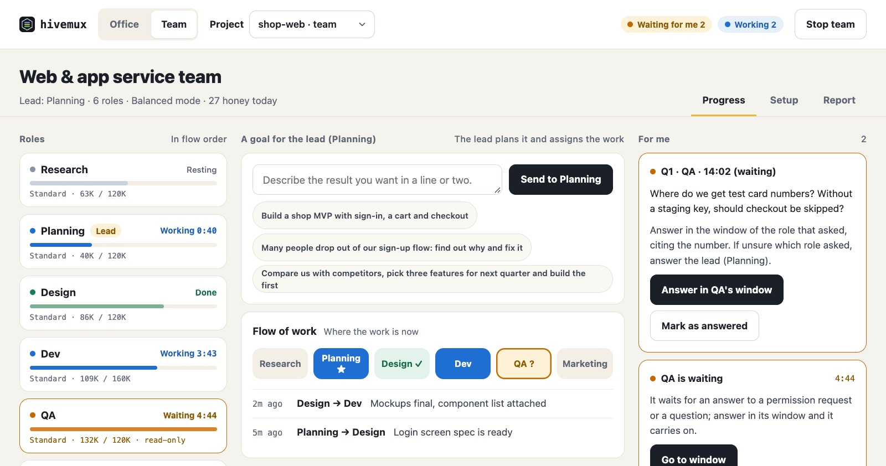
</p>

A team is a few Claudes with roles in one project, each in its own window,
passing work to each other by name with Claude Code's messages between
sessions. One role is the lead: you give it the team's goal, it plans and hands
the work out, and the roles pass what they finish down the flow.

- **Set one up.** Right-click a project's name → **Team…** (or the **Team** link
  at the top of the bee office) opens the team page. Pick a template, or answer
  three questions (what you are building, what you already have, what matters
  most) and the wizard suggests the roles with a reason for each. **Build the
  team with AI** opens a chat that answers questions about the team from the
  project's README and files, and applies the changes it proposes in one click.
  From a terminal: `hivemux team use web-app`, then `hivemux team up`.
- **The web & app template**: Research, Planning (the lead), Design, Dev (in its
  own git worktree), QA (read-only) and Marketing.
- **Roles without knowing the models.** Each role takes a level (Light,
  Standard, Careful, Best) and hivemux sets its model, effort, advisor (a
  stronger model it asks before settling an approach) and subagent model for
  that kind of role; or set them by hand. The page's header runs the whole team
  as Save, Balanced or Quality and shows what changes first. A role can also
  work in its own worktree (branch `team/<role>`), be read-only (it writes only
  its notes, questions and reports), own folders, and have its own prompt, with
  a preview of the final one.
- **Start it.** Start and stop the team or one role on the page. Getting
  started lists the roles stopped at Claude's folder trust question and answers
  them with one button; then a box sends the lead the goal, with example goals
  (`hivemux team goal "…"` does the same).
- **Hand-offs.** Every message from one role to another is logged. The team
  page lists the recent ones, the project's box in the sidebar shows the last
  one for half an hour (`✉ Planning → Dev · 2m`), and in the bee office a letter
  flies from one bee to the other. In the sidebar the roles sit together under
  `◆ <team name>`, the lead marked ★, the project's other Claudes after them.
- **Questions for you.** Roles write what they need from you to
  `.hivemux/questions.md`; the team page shows the open ones, each with **Mark
  as answered**, and what you type into a role's window marks its questions answered.
- **Diets.** hivemux notes how much context each Claude carries. A role past its
  line (120K tokens, 160K for dev) brings its notes up to date when it rests,
  `/clear`s and carries on from the notes under the same name, so the others
  keep messaging it. It never clears a window you are looking at, nor an answer
  to something you asked before you have read it: it waits until you have been
  away from that window for a minute (or left it untouched for five). Past half
  again its line it goes ahead and shows the last answer again after. An answer
  that asks you something waits in the same way and is shown again, with the
  role's open questions. A role keeps its notes short (8,000 letters, `notes` in
  `[diet]`) and starts fresh with them attached. Roles do without tools a team
  has no use for (`tools_off` in `team.toml`, for the team or a role), which
  every request would carry. The page shows each role's context against its line
  and has a **Diet now** button.
- **The day's report.** The **Report** tab of the team page (or `hivemux team
  report`): time worked, hand-offs, tasks done, tokens and diets; a timeline of
  who worked and waited when, with the hand-offs as arrows between roles; where
  the work went; what waited on you; each role's day (files, commits, tokens,
  honey); what got made. A small model writes the day's story on request; copy
  it as Markdown or save it as PDF.
- **In the bee office** a team gets a glass room on a team floor: the roles round
  a long table in flow order, the lead at its head, and a whiteboard with the
  flow, each role's state and its context. A working role types at its seat, a
  waiting one stands by it with a hand up, and a finished one takes its jar of
  honey to the lead.
- **It keeps.** `hivemux team down` stops the roles and keeps their
  conversations; after a reboot, clocking in or a Claude update each role
  resumes with its model, effort and prompt. The team lives in the project's
  `.hivemux/` (`team.toml` and a prompt per role); `hivemux team save <id>`
  keeps it as your own template. Teams on a computer connected with `hivemux
  connect` show on the team page and the report too (`⇄ <computer> · <project>`).
  **Disband team…** on the Setup tab (or `hivemux team disband`) closes the role
  Claudes and moves the team's settings to `.hivemux/disbanded/`; notes,
  reports and worktrees stay.

<p align="center">
  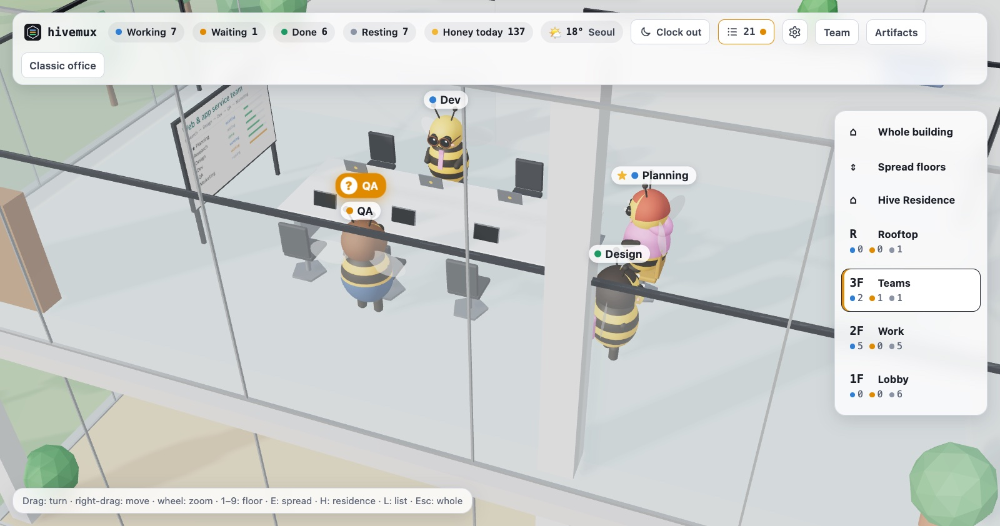
</p>

## The bee office

<p align="center">
  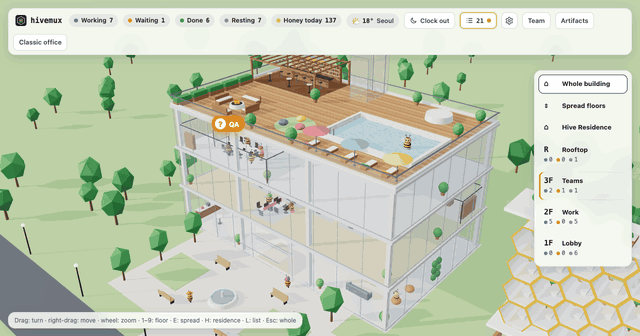
</p>

The 🐝 button at the top of the sidebar (or `prefix B`, the right-click menu,
`hivemux office`) opens a window where every Claude session is a bee, each with
a look of its own, at work in a glass office building in 3D:

- **The building.** A lobby with the cafe, the lounge, ping-pong and the honey
  wall, opening onto the plaza; work floors with a desk island per project, a
  meeting room and the boss's office; team floors with a glass room per team
  (see [Teams](#teams)); a rooftop with a pool, a hot tub, a pub and a fire pit;
  and across the plaza the Hive Residence, a flat for every bee. A glass lift
  carries the bees between floors.
- **Working** bees type at their desks (their screens scroll code) while their
  subagents fly papers to and fro. A Claude in plan mode plans at the meeting
  room whiteboard.
- **Waiting** bees raise their hand with a bubble saying why. The one that has
  waited longest pops out in front with its question and the choices to answer
  it there, with a buzz if you like.
- **Done** bees hold up a jar of honey; once you have looked, they go down to
  the lobby or up to the roof to rest. The honey wall in the lobby fills a cell
  for every task finished today, and a full comb puts a jar on the shelf under it.
- **Moving around.** Drag to turn, right-drag to move, wheel to zoom; the walls
  facing you are cut away. The floor bar on the right lists the floors with how
  many bees work, wait and are done on each: click one (or `1`–`9`) to open it,
  `Esc` for the whole building, `E` to spread the floors apart, `H` for the Hive
  Residence. Zoom far out and the office sits on a little planet in space.
- **The real sun and weather.** The sun stands where it really is for the date
  and place, and the weather shows outside: rain with puddles and umbrellas,
  snow, fog, lightning. A chip at the top shows the temperature and the place,
  found from your IP; ⚙ → Weather place (or a click on the chip) takes a city
  instead or turns the weather off.
- Click a bee to jump to its session. The ☰ button (or `L`) opens the session
  list as a drawer; its **Honey** tab ranks bees by the honey they made today,
  this week and this month.
- The ⚙ settings: pop out in front or just line up, sound, hiding task or
  project names for screen sharing, the real sun or always day or night, the
  office lights at night, going to the floor of a waiting bee, the list's side,
  and keep on top (`⌘T`).
- **2D, where 3D is too much.** Without 3D graphics (WebGL 2: a virtual machine
  without a GPU, an old browser) the office opens as a cartoon cross-section of
  the same building: every floor, the roof and the Hive Residence on one screen,
  the same bees doing the same things, the same cards to answer from. The wheel
  or a pinch zooms, a drag moves, and a floor clicked fills the window. ⚙ → View
  switches between the 3D building and 2D on any computer.
- A bee's name tag shows the name you gave its session (`hivemux` rename or
  Claude's `/rename`); bees with none show the project, numbered `api #1`,
  `api #2` among themselves.
- The **Team** link at the top opens the team page (see [Teams](#teams)), and
  **Pages** lists the HTML pages and artifacts your Claudes made (see
  [Pages](#pages)).
- The bees of computers connected with `hivemux connect` work in the same
  building; the list groups the sessions by computer.
- Without the Swift compiler for the window app (always so on Linux), it opens
  as an app window in Chrome, Chromium, Edge, Brave, Vivaldi or Whale (no tabs
  or address bar), else in the default browser. On a Linux server with no
  desktop, the 🐝 button says to connect from another computer with
  `hivemux connect`, and the office opens there. If the office server goes away, the page says it is
  reconnecting and keeps trying; the office window starts the server again.

<p align="center">
  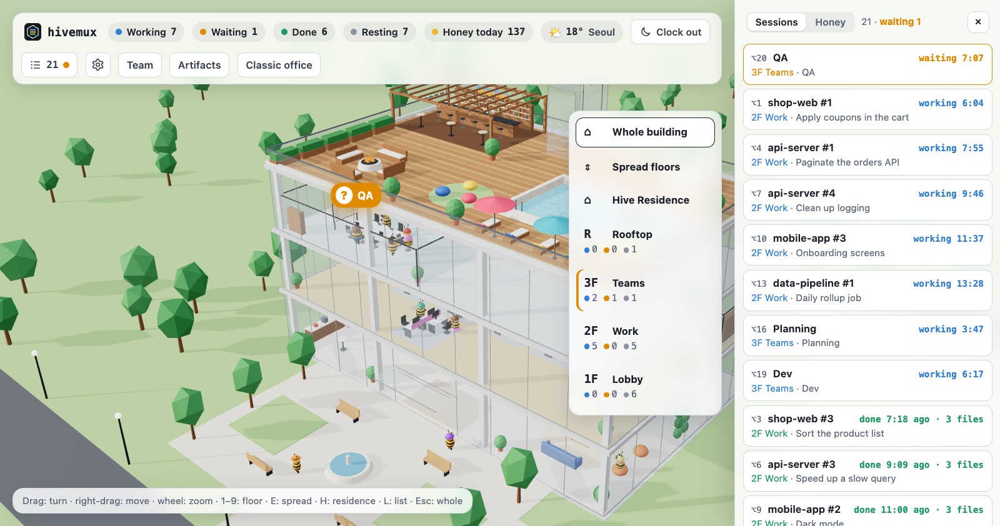
  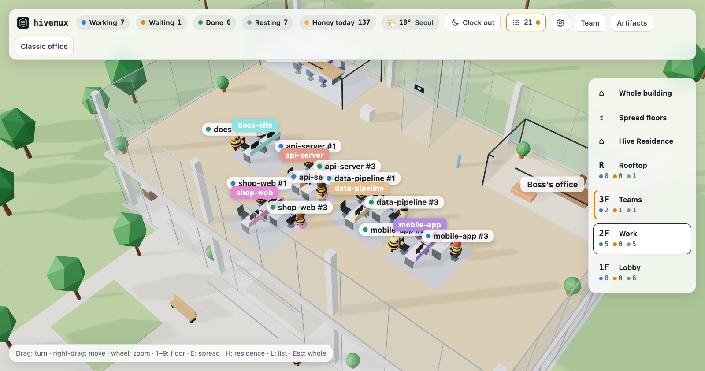
</p>

### Answering from the office

A bee waiting for you holds up a big bubble with why: ✋ an approval (the
command's description Claude wrote, or the file it wants to change), 📋 a
plan, ❓ a question, ✎ an MCP server asking, ⚠ an error. Click the bubble (or
the bee) and the card shows the same choices as the terminal: press one and it
is answered there. A choice that takes words (Type something, Tell Claude what
to change) opens a box; several questions go one by one, then a review. It
works for bees of a connected computer too. Nothing is pressed if the screen has
changed meanwhile.

### Clock out, clock in

<p align="center">
  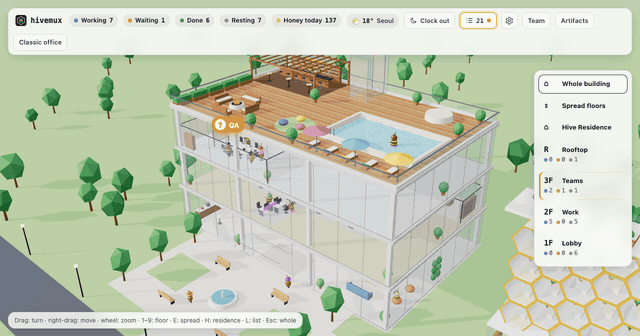
</p>

The 🌙 **Clock out** button at the top of the office (or right-click on empty
sidebar space → Clock everyone out…) stops your Claudes for the night, computer
by computer or all at once. The bees clap, walk out along the path to the Hive
Residence, fly up to their own flat and go in; the lamp comes on, they watch
TV, read or look at their phones, and late at night they sleep. A Claude still
working or waiting for you works overtime and goes once done. Clock in and every
one comes back in the same conversation (`claude --resume`) while the bees fly
down and walk back to work. A reboot while clocked out leaves them home.

One Claude or one project can also go home on its own while the rest work on:
right-click its card → Clock this Claude out…, or a project's name → Clock this
project out… Its card stays in the sidebar, dimmed ("home · right-click to
clock in"); right-click it → Clock in brings it back in the same conversation
(a plain click does nothing, so a slip while picking a project is harmless).
Clocking everyone in brings it back too.

<p align="center">
  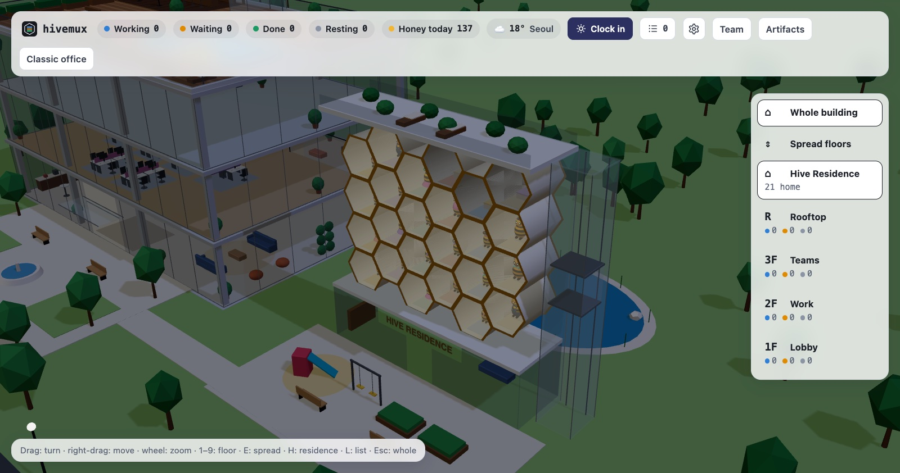
  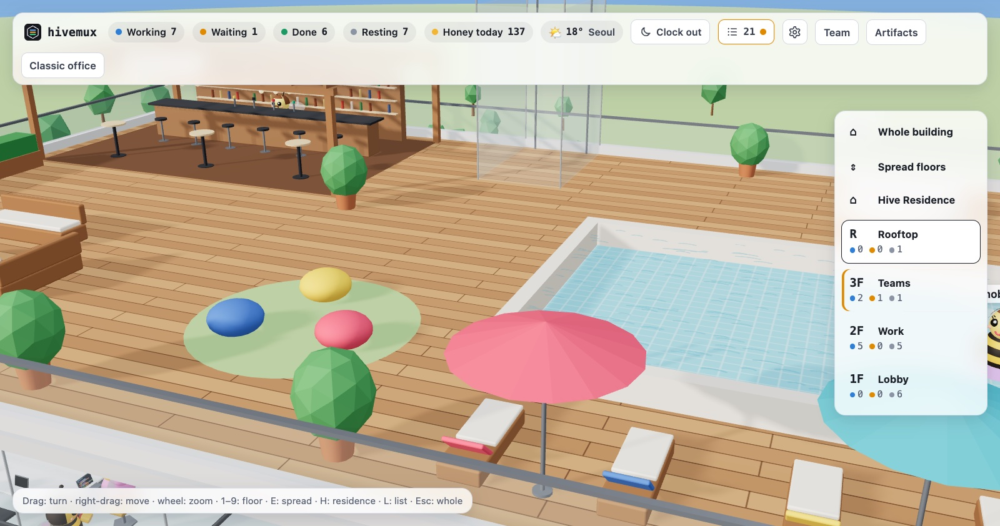
</p>

A bee is a project and the Claude's name in it, so it stays the same bee, with
the same look and flat, across `/clear`, new conversations and restarts. A new
name is hired; closing that Claude (`/exit`, right-click its card → Close
Claude…, or its window for ten minutes) or its project is leaving, and its flat
stays empty with a sign until a newcomer moves in. The same name coming back is
rehired, into its old flat if it is still free. The honey ranking marks who left
and how often a bee was rehired.

## More than one Claude account

When one Claude account reaches its usage limit, log in to another and switch
to it; every Claude carries on in the same conversation.

- **Add an account.** Right-click the sidebar → **Switch account…** →
  **Add account…**, give it a name (`work`), and log in in the browser once
  (or `hivemux account add work`).
- **Switch.** Pick it in the same popup (`hivemux account use work`). It first
  says how many Claudes, in which projects, will restart, and asks. Those
  restart on the new account in the same conversation (`claude --resume`):
  at once when at rest or stopped by the usage limit, after the turn when
  working. New windows start on it too.
- **One project.** Right-click a project's name → **Account for this
  project…** gives that project its own account (`hivemux account use work -s
  api`); "Same as all projects" undoes it.
- **Shared with someone.** Right-click a card → **Hide from the Claude app**
  (or a project name → **Hide this project from the Claude app**, its team
  too) keeps those Claudes out of the Claude app and claude.ai: hivemux
  disconnects their Remote Control through `/remote-control` (a busy one when
  its turn ends), and again whenever it connects anew (a restart, a resume).
  It holds through `/clear` and reboots; the same menu item connects them
  again. A whole account: `hivemux account hide shared`.
- **Go on with an API key at the limit.** In the same popup, **Add API key
  account…** adds an account that runs on an Anthropic API key (it asks for
  the key, checks it, and answers Claude Code's "use this key?" for you), and
  **At a usage limit, go on with** picks it (the first one added is picked).
  From the shell: `hivemux account add-key api`, `hivemux account fallback
  api`. Then the Claudes of a subscription that hits its usage limit move onto
  that key in the same conversation, and the one the limit cut off is asked
  to go on. So do those of a subscription Claude Code cannot use (a payment
  past due, billing, an account on hold), for a day or until you choose that
  account again. When the limit resets (the time in the limit message, else five
  hours), they move back once they are off the screen and not working. API
  use is billed per request. `hivemux account fallback off` stops it. A
  project can have its own: the same row in **Account for this project…**
  (`hivemux account fallback api|off|all -s <project>`), so only the projects
  you pick go on with the key.

  It goes on through the **Agent SDK** by default. Max, Ultra and Team plans
  include [monthly API credits](https://support.claude.com/en/articles/17154008-monthly-api-credits-for-max-ultra-and-team-plans)
  ($100, $200, up to $500 a team; claim them in claude.ai → Settings → Billing,
  which links a Console organization). They cover the Agent SDK with a key of that
  organization and not Claude Code, which stops at "Credit balance too low" on
  them. `bin/hivemux-sdk` is hivemux's own terminal for Claude, made with the SDK
  and laid out like the one you know: it runs in the pane with the same folder,
  tools, settings, CLAUDE.md, hooks and team role prompt. The conversation passes as
  documents, as a diet does: it starts from a handoff written from the end of
  the Claude Code conversation (`~/.local/share/hivemux/handoff/<id>.in.md`:
  the last requests and answers, files changed, the role's notes, the path of
  the whole conversation) and writes what it does to `<id>.back.md` after each
  turn. When the subscription can be used again it turns back into Claude Code
  on the same conversation at a quiet moment, and Claude Code reads
  `<id>.back.md` first. Set the project to another API key account meanwhile
  and it starts again on that key at a quiet moment, resuming the same SDK
  conversation as it was (a reboot on the API resumes it too). It diets as a
  team role does (each API turn sends the whole conversation again and is
  paid for): past the line, once you have seen the answer, it brings its notes
  up to date and starts a fresh SDK conversation from them. A team role keeps
  its team's line; any other Claude diets at 150K tokens (`tmux set -g
  @hivemux-sdk-diet 200`, or `off`). Its Python (`claude-agent-sdk`, `prompt_toolkit`) is
  set up once in `~/.local/share/hivemux/sdk/venv`, with Python 3.10 or newer.
  `hivemux account runner api claude` runs Claude Code on the key instead.
- **Where you are.** The status line shows `◉ work` when the account in use
  is not the default one. `hivemux account list` shows every account, its
  email and the projects on it.

An added account is a Claude config folder of its own
(`~/.local/share/hivemux/accounts/<name>`, used through `CLAUDE_CONFIG_DIR`):
only the login is its own. Settings, hooks, conversations, memory, skills,
plugins and the list of running sessions are shared with `~/.claude`, so a
conversation goes on under any account and Claudes on different accounts still
message each other. `default` is the login in `~/.claude`. `hivemux account
remove <name>` logs out and removes it.

### Pages

Right-click → **Pages…** (or the Pages link in the bee office) lists what your
Claudes made for you to see.

**HTML files**: those in the projects' `docs/` and in the roles' work folders.
Settings → **Pages to show** → **HTML files** makes it the way: a Claude writes
a page as one HTML file instead of publishing it, and publishes it as an
artifact only when you want it shared (in a team, one role does: `share = true`,
else the designer, else the lead; the others go without the Artifact tool, 13K
tokens less in every request). The setting applies from the next conversation;
a team can have its own on its page (`hivemux team pages`). From the list, open
a file or its shared copy, copy the request to share it, or the request to
gather what others said on the shared copy: their comments go to
`<name>.share.md` next to the file, and what you decide into the file.

**Artifacts**: an artifact (a claude.ai page a Claude published) opens only for
the account that published it. This lists every one, newest first, with the
account it belongs to, read from the conversation transcripts, so the ones
from before you added accounts are there too. For one of another account:

- **View copy** opens the copy hivemux keeps of the published file
  (`~/.local/share/hivemux/artifacts/`, taken while the file is still there).
- **Copy republish request** puts a request on the clipboard (title, file, old
  link) to paste to a Claude on the account in use.

## Requirements

- macOS, or Linux with tmux 3.3+: Ubuntu 24.04+, Debian 12+, Fedora, Arch
  (x86_64 and arm64). Ubuntu 22.04's tmux is 3.2, too old. Linux is tested on
  Ubuntu 24.04 (arm64)
- tmux 3.3+, jq, git, perl, python3 (on macOS: Homebrew and Xcode Command Line
  Tools; on Linux `hivemux setup` offers to install the missing ones)
- [Claude Code](https://code.claude.com) logged in
- [Ghostty](https://ghostty.org) recommended: `hivemux setup` offers to install it (any terminal works if you start `tmux` yourself)

## Install

```sh
curl -fsSL https://hivemux.dev/install.sh | bash
```

This clones hivemux into `~/.local/share/hivemux/src` and runs `hivemux setup`.

Homebrew (macOS):

```sh
brew install esteban-eg-kim/tap/hivemux
hivemux setup
```

`hivemux setup` asks three questions (all default to yes), and a fourth when
Ghostty is not installed yet:

| Question | What it changes |
|---|---|
| Install Ghostty | `brew install --cask ghostty`; on Linux see [Linux](#linux) (not with `--yes`) |
| Recommended keys | prefix `Ctrl+A` (Claude Code uses `Ctrl+B`), `\|` / `-` splits |
| Ghostty attaches to tmux | `command = hivemux-attach` in Ghostty config |
| Remote Control for all sessions | `remoteControlAtStartup` in `~/.claude/settings.json` |

It also downloads tmux-resurrect and tmux-continuum (or uses yours from
`~/.tmux/plugins`) and registers eleven Claude Code hooks. Run `hivemux doctor` to
check everything. Use `--yes` to accept defaults, `--no-keys`, `--no-ghostty`,
`--no-remote` to skip parts. The screen language follows your shell; pick it with
`--lang=en` or `--lang=ko`, and change it later in the sidebar's right-click menu → Settings.
When it is done it opens Ghostty, and on a first install the first window asks for a
project folder, so you can start without typing a command.

### Linux

Use the same command (the Homebrew formula is macOS only):

```sh
curl -fsSL https://hivemux.dev/install.sh | bash
```

- **Packages.** If tmux, jq, git or perl is missing, `hivemux setup` offers to
  install them with the distribution's package manager (apt, dnf, pacman,
  zypper or apk). It asks first, since it runs `sudo`; run without a terminal
  (or with `--yes`), it only prints the command. If the tmux there is older than
  3.3 (Ubuntu 22.04 has 3.2), setup stops and says so.
- **Ghostty.** With a desktop, setup offers Ghostty from the distribution's own
  package where there is one (Arch, openSUSE, Ubuntu 26.04+, Alpine), else the
  snap (a community build); with neither, it points to
  [ghostty.org/docs/install/binary](https://ghostty.org/docs/install/binary).
- **A server with no desktop** (say, one you reach over ssh): the Ghostty step is
  skipped. Run `tmux` there, or connect to it from your Mac with
  `hivemux connect` (see [Work from another computer](#work-from-another-computer)).
  `hivemux doctor` checks that the ssh server is running.
- **PATH** goes in `~/.bashrc` as well as `~/.zshrc`.
- **Keys.** `Option` in this README is `Alt` on Linux (`Alt+1`, `Alt+0`,
  `Alt+O`), and Ghostty's new window there is `Ctrl+Shift+N`.
- **Opening and copying** use `xdg-open`, the file manager (over the
  FileManager1 D-Bus interface), and `wl-copy`, `xclip` or `xsel` (else the
  terminal's clipboard through OSC 52).

### Other terminals

```sh
hivemux terminal iterm      # or wezterm, kitty, alacritty, terminal (Terminal.app), ghostty
hivemux terminal iterm --off
```

On Linux the choices are ghostty, wezterm, kitty and alacritty (iTerm2 and
Terminal.app are macOS apps).

Makes that terminal open every window inside tmux with the sidebar, the way Ghostty
does. Run from one of them, `hivemux setup` offers it too (default no). It writes only
its own block, or for iTerm2 a profile of its own ("hivemux", made the default), so
`--off` and `hivemux uninstall` take out just that. Terminal.app starts it from
`~/.zshrc`; turn on Settings → Profiles → Keyboard → Use Option as Meta key there for
the Option keys.

### Update

```sh
hivemux update    # --yes: no question; --check: only look
```

hivemux looks for a new version once a day. When one is out, the sidebar's bottom
line becomes "0.1.x · update hivemux" and the bee office's ⚙ gets a dot; click
either (or right-click → Update hivemux) to see what changed and update in place.
It updates with brew (Homebrew install) or git (script install), runs `hivemux setup`
again with the answers you gave the first time, reloads tmux and restarts the
sidebars and the bee office, so you keep working in the same sessions. Settings →
hivemux updates: Tell me (default), Automatic (at a moment when no Claude is working
or waiting for you) or Never check. Claude sessions started before the update pick
up new hooks once restarted. Up to 0.1.65, which has no `hivemux update`, update
once by hand: `brew update && brew upgrade hivemux && hivemux setup` (Homebrew) or
the install command again (git install). Claude Code itself: right-click → Update Claude
(`hivemux update-claude`, `--yes` to skip the question). `hivemux version` shows the installed version; see
[CHANGELOG.md](CHANGELOG.md) for what changed.

## Quick start

1. Open Ghostty. You are inside tmux; the sidebar is on the left. Right after the
   install, a folder picker asks for your first project: pick a folder, press `Enter`,
   and Claude starts in it.
2. `hm ~/code/api` (or right-click → New project) opens project **api** with Claude running in window 1.
3. `hm ~/code/web` opens a second project. The first keeps working.
4. Watch the sidebar. `Option+0` takes you to whatever is waiting for you (on Linux, `Alt` for `Option` throughout).
5. `prefix` then `Shift+C` adds another named Claude to the current project.
6. Close Ghostty whenever you like. Open it again and you are back where you were.

## Keys

| Key | Action |
|---|---|
| `Option+1` … `9` | jump to that Claude (any session) |
| `Option+0` / `prefix Space` | oldest waiting Claude, else oldest unseen finished one |
| click card / project name | jump · double click a card: rename. A project whose Claude windows are all closed stays listed ("no Claude") until you close it |
| right click | menu. On a task: go to, rename, move up/down, clock this Claude out, close Claude, new Claude, new project. On a clocked-out (dimmed) card: clock in, go to, close Claude. On a project name: rename, Team…, close project, account for this project, clock this project out / in, new Claude, new project. On empty space: new project. Every menu ends with Open path…, Ports…, Bee office, Pages…, (on empty space: Clock everyone out / in…), Update Claude…, Update hivemux…, Switch account…, Connect to…, Sidebar width… and Settings. Choose with the mouse, `↑↓` `Enter` or the letter shown; `Esc` closes. A popup that asks starts on Cancel, so `Enter` alone never confirms |
| menu → Team… | the project's team page in the bee office window: set up, start and stop a team, send the lead a goal (see [Teams](#teams)) |
| menu → Close Claude | asks, then closes that Claude: its pane, or its window when nothing else is in it; a project's last window keeps its shell. Not resumed again, like `/exit`; `claude --resume` still continues the conversation |
| menu → New project | folder browser in the middle: `Enter` starts the selected folder (like `hm`), `→` / `←` in and out, type to filter, `Ctrl+N` new folder |
| menu → Sidebar width | Narrow 24 / Medium 32 / Wide 44 or a width of your own, applied once on Enter |
| menu → Settings | language (한국어 / English), animation, notifications, sidebar width, width drag (live, or on release), editor for Open path, this computer's name (shown in the bee office and on remote screens); applied at once and saved |
| drag card / project header | reorder tasks / projects |
| `prefix Shift+↑` / `↓` | move the current task up / down (at a project's edge, the project moves) |
| `Option+O` / menu → Open path | open a file path or link from recent output (Enter editor from Settings, Tab default app, ^F Finder or the file manager, ^Y copy; on a screen from another computer, on that computer). Links include the address under a link's text, which a terminal shows without it: Enter opens it in the browser of the computer you look from |
| `Option+W` / menu → Ports | dev server ports forwarded between computers (Enter opens in the browser of the computer they reach, p opens one to that computer's Wi-Fi for a phone with its address and QR code, ^Y copies the address) |
| `prefix Shift+C` | new window with a named Claude in this folder (asks the name in a popup) |
| menu → Connect to… | another computer's hivemux in a new Ghostty window (hosts added with `hivemux connect --add`) |
| `prefix Shift+H` | connect to the last remote host again |
| `prefix Shift+B` | open the bee office window (also the 🐝 button at the top of the sidebar) |
| `prefix Shift+R` | Remote Control server window (start new sessions from the phone) |
| `prefix b` | hide / show sidebars |
| `prefix <` / `>` | sidebar 4 columns narrower / wider (keep pressing for more) |
| `prefix s` / `prefix Shift+S` | session list / full tree |
| drag the sidebar grip | resize; width is saved. Wider: project boxes in 2–3 columns. On a screen from another computer a guide line follows the mouse and the width changes once on release (Settings → Width drag) |
| mouse wheel on the sidebar | scroll when the list does not fit (shared by every window) |

`prefix` is `Ctrl+A` with the recommended keys, otherwise tmux's `Ctrl+B`. On
Linux, `Option` is `Alt`.

<p align="center">
  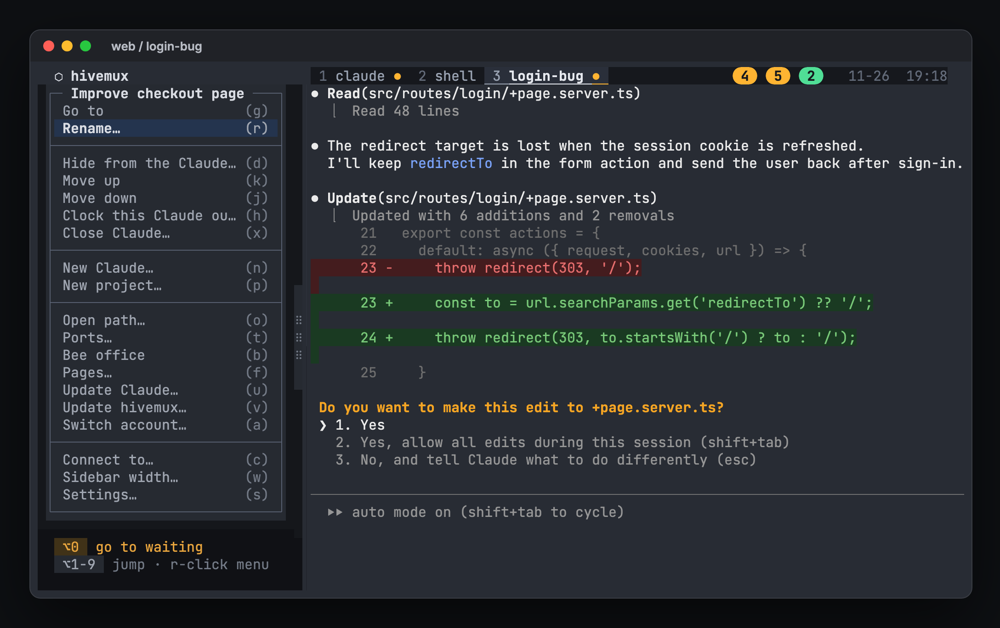
  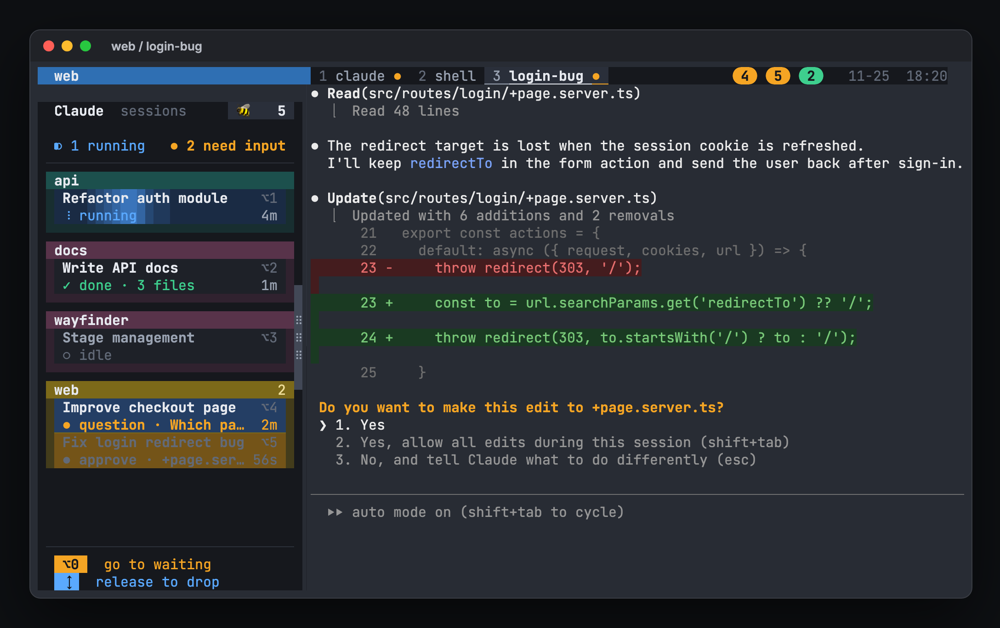
  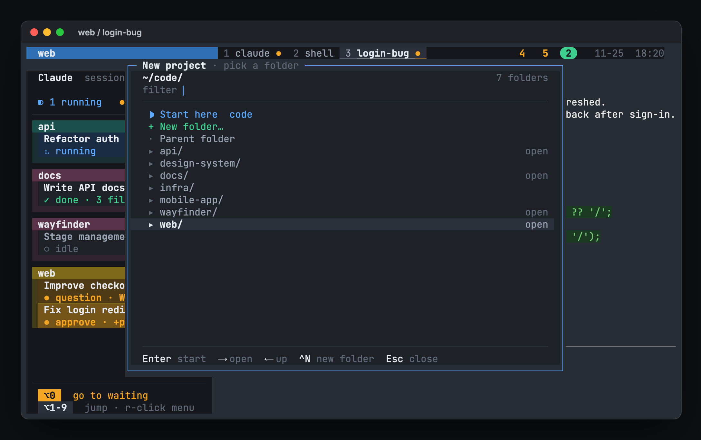
  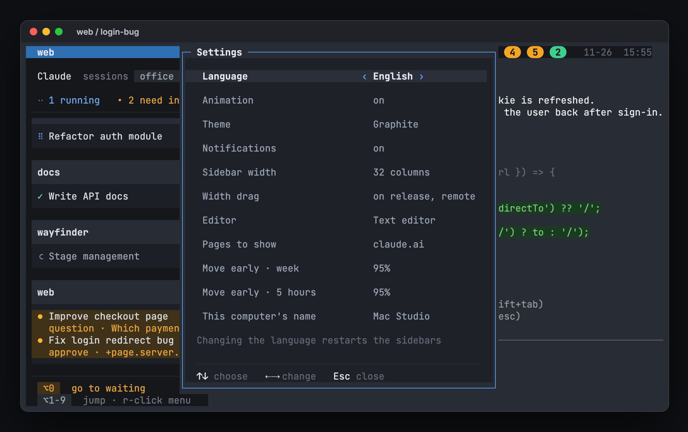
</p>

## Work from another computer

Keep the work running on one computer (say, the Mac at the office, or a Linux dev
server) and continue it from another (a laptop): the laptop attaches to the first
one's tmux over ssh and sees the same sidebar and sessions. If the connection
drops, the work goes on. Local work on the laptop stays as it is; the remote one
opens in its own window. Macs and Linux machines connect either way: Mac to Mac,
Mac to Linux, Linux to Mac, Linux to Linux.

Plenty of tools get you a remote terminal. What hivemux adds is that the two
computers stop feeling like two: the screenshot you just took on the laptop, the dev server
running on the desktop, the file Claude made over there all work as if Claude
ran on the laptop.

<p align="center">
  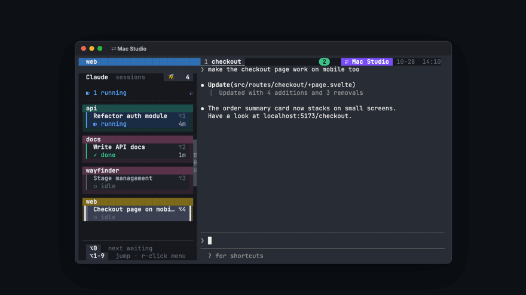
</p>

### Set it up

On the computer you connect **to**: install hivemux, and
- a Mac: turn on System Settings → General → Sharing → **Remote Login**, and keep
  it from sleeping when idle;
- Linux: run an ssh server (package `openssh-server` or `openssh`, then
  `sudo systemctl enable --now ssh` or `sshd`). A server with no desktop is
  fine; setup skips Ghostty there.

On the computer you connect **from**:

```sh
hivemux connect --add me@work-mac.local    # check and remember (--mosh to use mosh)
hivemux connect me@work-mac.local          # or: right-click → Connect to…, prefix Shift+H
```

The first time, `--add` (or "+ Add a host…" in the Connect to… list) asks you to
trust the host and for your login password there once, then adds this computer's ssh
key there (making one if there is none), so later connections need no password.

The host is anything `ssh` takes: a `Host` from `~/.ssh/config`, `user@address`,
or a device name on a VPN. On the same network `name.local` works; from outside,
a VPN such as [Tailscale](https://tailscale.com) on both computers is the simple way
(opening ssh to the internet with port forwarding is not recommended).

Keep hivemux up to date on both computers. When one side is too old for the
other, the screen says so as you connect, with the computer to update and the
command (`brew upgrade hivemux`); `hivemux connect --add` says it too. If
`hivemux version` shows an old version though you upgraded, another copy comes
first in your `PATH`: `hivemux doctor` (run as `/opt/homebrew/bin/hivemux doctor`)
names it and the line that adds it.

### Paste screenshots with Ctrl+V

Claude Code reads images from the clipboard of the computer it runs on, so over plain
ssh a screenshot taken on your laptop never reaches it. In a remote Claude pane,
press `Ctrl+V` as usual: hivemux copies the image on the laptop's clipboard over
and it shows up in Claude as `[Image #1]`. Take a screenshot of the broken page
(`⌘⌃⇧4` puts it on the clipboard), `Ctrl+V`, ask what is wrong. Both computers
need hivemux 0.1.26 or later. On a Linux laptop the image comes from `wl-paste`
(Wayland) or `xclip` (X11).

Files work the same way: copy a PDF (or any file) in Finder with `⌘C`, press
`Ctrl+V` in the remote Claude pane, and the file goes over under its own name
with its path pasted for Claude to read. Several at once, no folders, up to
100 MB in all; from 5 MB the status line there shows the progress
(`📎 report.pdf and 2 more… 45%`). Both computers need 0.1.52 or later.

<p align="center">
  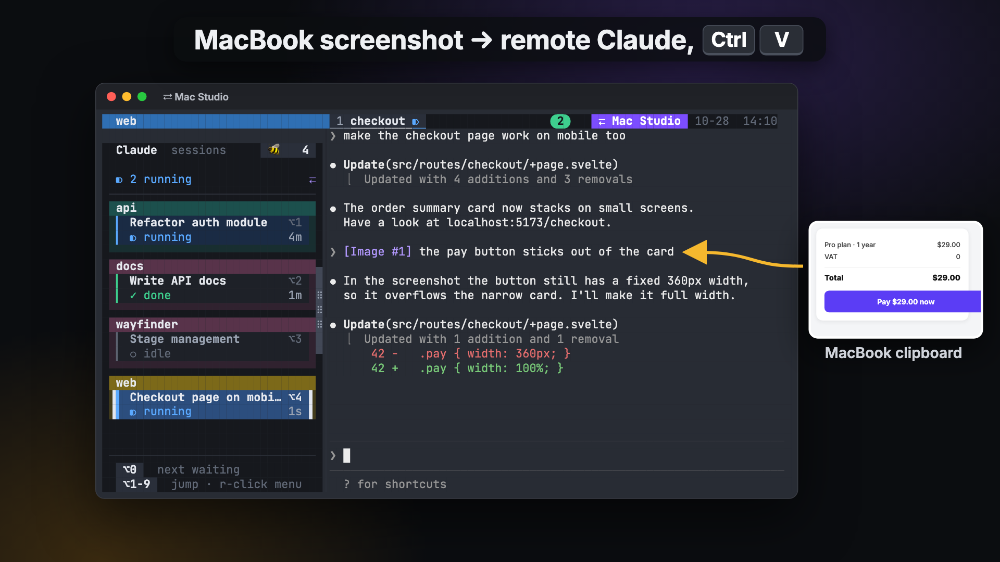
</p>

### What else comes along

- **Dev servers on your `localhost`.** A server started there (`npm run dev` in a
  remote pane) is forwarded to the same port on this computer's `localhost` while
  connected; a port taken here goes to the next free one. `Option+W` (or menu →
  Ports) lists them on either side; Enter opens one in the browser of the
  computer you connect from, and `p` opens it on that computer's Wi-Fi too, with
  the address and a QR code for a phone (`p` again closes it). A Linux server without `lsof` is read with `ss` and
  `/proc`, and a server that systemd took over is still found.
  `HIVEMUX_PORTS=0` turns it off.
- **Files open on the laptop.** `hivemux open <file>` in a remote pane (or Enter,
  Tab or Ctrl+F in the `Option+O` popup) copies the file to this computer and opens it
  with its default app, so a screenshot Claude made there shows up here. With the
  editor set to VS Code or Cursor, Enter opens the path over Remote-SSH instead.
  Folders cannot be copied over; Ctrl+Y puts the path on this computer's clipboard. The 🐝 button
  there opens the bee office here. Both computers need hivemux 0.1.29 or later.
- **Notifications here.** A remote task that needs you or finishes shows a
  notification on this computer.
- **The connection looks after itself.** A dropped connection reconnects by
  itself: a box in the middle counts down to the next try (`Enter` tries now,
  `Ctrl+C` stops); `prefix d` detaches and closes the window. With `--mosh` (or
  `m` in the menu → Connect to… list), the session survives sleep and network
  changes by itself, but notifications do not pass through mosh; the list marks
  such a host "mosh · no notifications". Both computers need mosh (`brew install
  mosh` on a Mac, the `mosh` package on Linux); if it stops at "Nothing received
  from server on UDP port", allow incoming connections for `mosh-server` in the
  other computer's firewall.
- **You always know where you are.** The remote window shows `⇄ <name>` at
  the right of the status line, before the clock: the name from Settings, else
  the Mac's name or the Linux host name, and the round trip to it (`24ms`). Over
  150 ms the badge turns orange; a connection slow for a while suggests mosh once.
  ssh compresses the screen, and popups open without the extra copy window on
  tmux 3.8, so less goes over a slow connection.
- **A new window.** On a Linux desktop, a new connection window opens in
  Ghostty, else the desktop's terminal (`x-terminal-emulator`).
- **Two screens, one project.** Two screens on the same project share it:
  switching windows on one moves the other.
- **Light on the network.** While a remote screen looks at a window, its sidebar
  keeps still (no pulsing cards, no status line spinner): every animation frame
  would go over the network.

## How it works

| Layer | Job |
|---|---|
| Ghostty | draws. Every window runs `hivemux-attach`, which attaches to tmux |
| tmux | keeps processes alive when the terminal closes |
| tmux-resurrect + continuum | saves layouts every 5 minutes, restores on first launch |
| Claude Code hooks | write session id and state onto the tmux pane (`hivemux-hook`) |
| sidebar | reads that state every second and draws the board (`hivemux-sidebar-view`) |
| bee office | a small local server (`hivemux-office`) serves the office page to its window; `hivemux-bees` keeps the roster and the honey ledger, `hivemux-shift` clocks out and in |
| teams | `hivemux-team` keeps a project's team in its `.hivemux/` and starts each role's Claude with its model, effort and prompt; the hook logs hand-offs and puts a role past its line on a diet |
| accounts | `hivemux-claude` starts Claude on the project's account; `hivemux-account` adds and switches them, `hivemux-artifacts` lists the HTML pages and reads the artifacts from the transcripts |

On restore, `hivemux-panes` maps saved panes to Claude session ids and types
`claude --resume <id>` in each. Sessions you ended with `/exit` are not resumed,
and none are while you are clocked out.

## Troubleshooting

```sh
hivemux doctor                         # check dependencies, wiring and the ssh server
hivemux-panes list                     # panes hivemux will resume after reboot
tmux set -g @hivemux-anim off          # stop animations (to keep them off: menu → Settings)
tmux set -g @hivemux-fps 5             # fewer animation frames (default 15)
hivemux-sidebar respawn                # restart every sidebar
touch ~/tmux_no_auto_restore           # skip restore on next launch
```

A sidebar that hits an error starts again in the same pane and writes what
happened to `~/.local/share/hivemux/sidebar-errors.log`; include it when you
report a bug.

On Linux, `tmux 3.2: need 3.3 or newer` means the distribution's tmux is too old
(Ubuntu 22.04): use Ubuntu 24.04+, Debian 12+, Fedora or Arch.

More in the docs at [hivemux.dev/docs](https://hivemux.dev/docs/), or the illustrated guide: [`docs/guide.en.html`](docs/guide.en.html) ([한국어](docs/guide.html)); download it and open it in a browser.

## Uninstall

```sh
hivemux uninstall
```

Removes the hivemux blocks from `~/.tmux.conf`, Ghostty config, `~/.zshrc` and `~/.bashrc`,
and the hivemux hooks from Claude Code settings. Saved layouts and backups stay
in `~/.local/share/hivemux`.

## License

MIT. hivemux is an independent project and is not affiliated with or endorsed
by Anthropic. "Claude" and "Claude Code" are trademarks of Anthropic.
